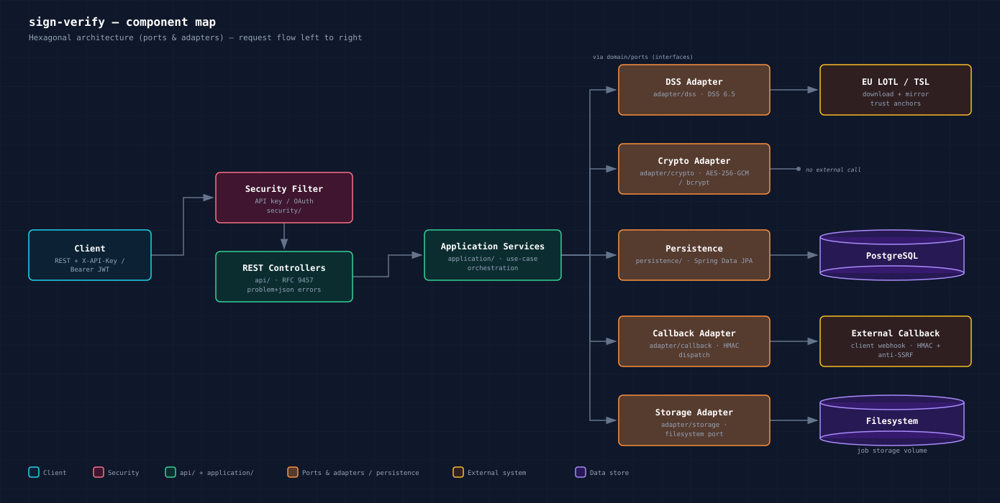

# sign-verify

[](https://github.com/toresoft/sign-verify/actions/workflows/ci.yml)
[](https://gitlab.com/toresoft/sign-verify/-/pipelines)
[](https://gitlab.com/toresoft/sign-verify/-/commits/main)
[](https://hub.docker.com/r/toresoft/sign-verify)
[](LICENSE)

> 🇮🇹 **Questo documento è in italiano.** · 🇬🇧 [Read this in English](README.md)

> Servizio REST per la **verifica di firme elettroniche eIDAS** (PAdES, CAdES, XAdES, JAdES, ASiC), basato su Spring Boot 4.1 e sulla libreria europea **DSS 6.4**, con gestione delle Trusted List UE (LOTL/TSL).

---

## 1. Descrizione dell'applicazione

`sign-verify` controlla i documenti firmati digitalmente rispetto agli standard eIDAS e
dice se la firma è valida. Restituisce un esito (`indication`/`subIndication`) più i
report di validazione DSS (Simple, Detailed, Diagnostic, ETSI).

**Funzionalità principali**

- Verifica della firma, sia sincrona sia asincrona (job più callback HTTP firmata in HMAC).
- Profili di verifica configurabili (`BASIC`, `STANDARD`, `STRICT`, `AGID`,
  `AGID_TS`, `CUSTOM`), con la possibilità di modificare la policy per singola
  richiesta.
- Estrazione del documento originale da un contenitore firmato.
- Gestione delle liste di fiducia: scaricamento e copia locale della lista europea
  delle liste (LOTL), aggiornamento pianificato, consultazione dei certificati.
- Autenticazione via API key (`X-API-Key`) e/o OAuth2 JWT, con ruoli `STANDARD` e
  `PRIVILEGED`.
- Registro di audit e strumenti di monitoraggio (vitalità e prontezza, metriche
  Prometheus, log in JSON), con conservazione e pulizia automatiche dei job.

**Formati di firma supportati:** PAdES (PDF), CAdES (CMS), XAdES (XML), JAdES (JSON),
ASiC-S/ASiC-E.

### Architettura

Architettura esagonale (porte e adattatori), verificata da ArchUnit.



| Strato | Pacchetto | Responsabilità |
|---|---|---|
| API | `api/` | Controller REST sottili e gestore degli errori RFC 9457 (`problem+json`) |
| Applicazione | `application/` | Logica dei casi d'uso: verifica, profili, job asincroni, liste di fiducia, audit |
| Dominio | `domain/` | Modello, enumerazioni, **porte** (interfacce), eccezioni |
| Adattatori | `adapter/` | Implementazioni delle porte: DSS, crittografia, callback, memorizzazione documenti |
| Persistenza | `persistence/` | Repository Spring Data JPA |

---

## 2. Configurazione

La configurazione segue lo schema abituale di Spring Boot: un `application.yaml` di base,
pensato per la **produzione**, più i file dei singoli profili. Tutte le chiavi si possono
sovrascrivere con variabili d'ambiente.

### Profili Spring

| Profilo | Uso | Caratteristiche |
|---|---|---|
| *(nessuno)* | **Produzione** | OAuth abilitato, dati in `/var/lib/sign-verify`, liste di fiducia attive |
| `dev` | Sviluppo sulla macchina locale | H2 in memoria, OAuth disabilitato, chiave master di sviluppo, dati in `./target` |
| `docker` | Sviluppo in container | OAuth disabilitato, caricamento delle liste saltato, dati in `/var/lib/sign-verify`, sorgente dati da variabili d'ambiente |

Attivazione: `-Dspring.profiles.active=dev` (host) oppure `SPRING_PROFILES_ACTIVE=docker`
(container).

### Variabili d'ambiente principali

| Variabile | Descrizione | Predefinito |
|---|---|---|
| `SPRING_DATASOURCE_URL` | URL JDBC del database | H2 in memoria |
| `SPRING_DATASOURCE_USERNAME` / `_PASSWORD` | Credenziali del database | `sa` / *(vuoto)* |
| `APP_SECRET_MASTER_KEY` | **Chiave di cifratura dei segreti**, base64 di 32 byte (256 bit) | *(obbligatoria)* |
| `APP_SECURITY_OAUTH_ENABLED` | Abilita il resource server OAuth2 con JWT | `true` |
| `APP_SECURITY_OAUTH_ISSUER_URI` | Issuer OIDC (obbligatorio se OAuth attivo) | *(vuoto)* |
| `APP_SECURITY_OAUTH_ROLE_CLAIM` | Claim del JWT che contiene i ruoli | `roles` |
| `APP_SECURITY_OAUTH_PRIVILEGED_VALUES` | Valori del claim che danno ruolo `PRIVILEGED` | `admin,privileged` |
| `APP_SECURITY_BOOTSTRAP_KEY_FILE` | Percorso del file in cui viene scritta la chiave iniziale al primo avvio | `/var/lib/sign-verify/bootstrap-api-key.txt` |
| `APP_STORAGE_JOBS_DIR` | Directory dei job asincroni | `/var/lib/sign-verify/jobs` |
| `APP_STORAGE_TYPE` | Dove salvare i documenti: `filesystem` o `s3` | `filesystem` |
| `APP_STORAGE_S3_ENDPOINT` | Endpoint S3 (vuoto = AWS nativo) | _(vuoto)_ |
| `APP_STORAGE_S3_REGION` | Regione S3 | `eu-south-1` |
| `APP_STORAGE_S3_BUCKET` | Nome del bucket S3 | `sign-verify-jobs` |
| `APP_STORAGE_S3_PATH_STYLE` | Indirizzamento con il bucket nel percorso (`true` per MinIO e Ceph) | `false` |
| `APP_DSS_CACHE_DIR` | Cache DSS (TSL, CRL/OCSP) | `/var/lib/sign-verify/dss-cache` |
| `APP_OJ_KEYSTORE_PASSWORD` | Password del keystore della Gazzetta Ufficiale UE (verifica LOTL) | *(vuoto)* |
| `SERVER_PORT` | Porta HTTP | `8080` |
| `JAVA_TOOL_OPTIONS` | Opzioni aggiuntive per la JVM | valori adatti al container |

> Con `APP_STORAGE_TYPE=s3` le credenziali arrivano dalla catena predefinita di
> AWS SDK (`AWS_ACCESS_KEY_ID` e `AWS_SECRET_ACCESS_KEY`, ruoli IAM o IRSA,
> profili locali): nessuna proprietà applicativa contiene segreti. Il bucket deve
> esistere già, perché all'avvio l'adattatore esegue una `headBucket` e in caso di
> esito negativo il servizio non parte.

> **Generare la chiave master**
> ```bash
> openssl rand -base64 32
> ```

Senza `APP_SECRET_MASTER_KEY` valida (32 byte), e senza `APP_SECURITY_OAUTH_ISSUER_URI`
quando OAuth è attivo, l'applicazione **si arresta all'avvio**.
Il database è gestito da Flyway (`db/migration`), con Hibernate in `ddl-auto: validate`.

### Autenticazione

- **API key**: header `X-API-Key: sv_<prefisso>_<corpo>`, con hash bcrypt a riposo.
  Al primo avvio, se non esiste alcuna chiave `PRIVILEGED`, ne viene generata una
  iniziale, scritta nel file indicato da `APP_SECURITY_BOOTSTRAP_KEY_FILE` con
  permessi `0600`. **Va letta e poi cancellata.**
- **OAuth2 con JWT**: si abilita con `APP_SECURITY_OAUTH_ENABLED=true` e l'issuer OIDC.

---

## 3. Esecuzione

### Prerequisiti

- JDK 21, per esempio installato con SDKMAN, e Maven 3.9 o successivo
- Docker e Docker Compose, per gli ambienti in container

### a) Sviluppo sulla macchina locale (H2 in memoria)

```bash
mvn clean package
java -Dspring.profiles.active=dev -jar target/sign-verify-2.jar
# la chiave iniziale finisce in ./target/bootstrap-api-key.txt
```

### b) Sviluppo con Docker (applicazione e PostgreSQL)

```bash
docker compose up --build
```

Avvia l'applicazione con il profilo `docker` e un PostgreSQL 16. La documentazione
interattiva è su <http://localhost:8080/swagger-ui/index.html>.

### c) Produzione (immagine irrobustita)

```bash
cp .env.example .env      # compilare database, chiave master, issuer OAuth, password del keystore
docker compose -f docker-compose.prod.yml up -d
```

L'immagine è costruita a più fasi e in esecuzione usa **solo la JRE, senza privilegi di
root** (uid 10001); il file Compose di produzione applica `read_only`, `cap_drop: ALL`,
`no-new-privileges`, il `tmpfs` su `/tmp`, i limiti di risorse e un controllo di salute
sulla prontezza. Richiede un PostgreSQL gestito esterno.

---

## 4. Prima prova

Un esempio completo, dall'avvio alla risposta, con l'ambiente Docker di sviluppo e il PDF
firmato di esempio incluso nel repository
(`src/test/resources/assets/pades/sample-pades-valid.pdf`).

**1. Avvia l'ambiente**

```bash
docker compose up --build -d
```

**2. Recupera la chiave API iniziale** (ruolo `PRIVILEGED`, generata al primo avvio)

```bash
KEY=$(docker compose exec -T app cat /var/lib/sign-verify/bootstrap-api-key.txt)
echo "API key: $KEY"
```

**3. Verifica che il servizio sia attivo**

```bash
curl -s http://localhost:8080/actuator/health/readiness
# {"status":"UP"}
```

**4. Verifica una firma, in modo sincrono**

L'invio è multipart: la parte `file` è obbligatoria, le altre sono facoltative
(`profile`, cioè il nome del profilo, per esempio `AGID`; il deprecato `profileId` con
l'UUID; `profileOverrides` come oggetto JSON; `reports` con i valori separati da
virgola). Senza quelle parti valgono il profilo predefinito e i report `simple` ed
`etsi`. La vecchia parte `metadata` in JSON è ancora accettata ma **deprecata**, e non si
può usare insieme alle parti dedicate: mescolarle produce **400**.

```bash
curl -s -X POST http://localhost:8080/api/v1/verifications \
  -H "X-API-Key: $KEY" \
  -F "file=@src/test/resources/assets/pades/sample-pades-valid.pdf" | jq
```

Risposta (estratto):

```json
{
  "verifiedAt": "2026-06-08T10:15:30Z",
  "profileUsed": "STANDARD",
  "overridesApplied": false,
  "signatureFormat": "PAdES-BASELINE-B",
  "indication": "TOTAL_PASSED",
  "subIndication": null,
  "signatureCount": 1,
  "reports": { "simple": { }, "etsi": { } }
}
```

Il campo che conta è **`indication`**: `TOTAL_PASSED` se la firma è valida,
`TOTAL_FAILED` se non lo è, `INDETERMINATE` se l'esito non è determinabile, per esempio
quando nel profilo `docker` le liste di fiducia non sono state caricate.

**5. (Facoltativo) Scegli un profilo o i report**

Elenca i profili disponibili e ripeti la verifica indicandone l'id:

```bash
curl -s http://localhost:8080/api/v1/profiles -H "X-API-Key: $KEY" | jq '.[].id,.[].name'

curl -s -X POST http://localhost:8080/api/v1/verifications \
  -H "X-API-Key: $KEY" \
  -F "file=@src/test/resources/assets/pades/sample-pades-valid.pdf" \
  -F 'profile=AGID' \
  -F 'reports=simple,detailed' | jq
```

> **Nota sulla verifica effettiva dei certificati**: nel profilo `docker` le liste di
> fiducia non vengono caricate (`startup-mode: SKIP`), quindi la catena può risultare
> `INDETERMINATE`. Per una verifica completa serve la configurazione di produzione, con le
> liste attive e `APP_OJ_KEYSTORE_PASSWORD` impostata.

**Pulizia**

```bash
docker compose down -v
```

---

## 5. Test

```bash
mvn clean verify        # test unitari e di integrazione (Testcontainers), Spotless, JaCoCo
mvn spotless:apply      # formattazione (Google Java Format) prima del commit
```

---

## 6. Integrazione continua e pubblicazione su Docker Hub

Sono disponibili due catene di compilazione equivalenti:

- **GitLab CI**: `.gitlab-ci.yml`
- **GitHub Actions**: `.github/workflows/ci.yml`

Le fasi sono `validate → test → build → package → security`. La fase **package**
costruisce l'immagine e la pubblica su Docker Hub come `toresoft/sign-verify`:

- a ogni esecuzione sul ramo principale corrispondono i tag `:<short-sha>` e `:latest`
- a ogni tag git `vX.Y.Z` corrispondono i tag `:<short-sha>` e `:<tag>`

Le credenziali vanno impostate come variabili mascherate su GitLab
(Settings → CI/CD → Variables) oppure come segreti del repository su GitHub
(Settings → Secrets and variables → Actions):

| Nome | Valore |
|---|---|
| `DOCKERHUB_USERNAME` | account Docker Hub |
| `DOCKERHUB_TOKEN` | token di accesso Docker Hub (Account → Security) |

La fase **security** analizza immagine e filesystem con Trivy, limitatamente alle
vulnerabilità di gravità alta e critica, e controlla le dipendenze con OSV-Scanner sul
database OSV.dev.

### Costruire e pubblicare l'immagine a mano

```bash
docker build -t toresoft/sign-verify:dev .
echo "$DOCKERHUB_TOKEN" | docker login -u toresoft --password-stdin
docker push toresoft/sign-verify:dev
```

---

## 7. Guida d'uso dettagliata

La documentazione d'uso completa si trova sotto `docs/`, in italiano (`docs/it/`) e in
inglese (`docs/en/`), con diagrammi Mermaid. Indici:
[`docs/it/README.md`](docs/it/README.md) · [`docs/en/README.md`](docs/en/README.md).

| Argomento | 🇮🇹 Italiano | 🇬🇧 English |
|-----------|-------------|------------|
| Compilazione e configurazione | [01](docs/it/01-build-configurazione.md) | [01](docs/en/01-build-configuration.md) |
| Docker e configurazione | [02](docs/it/02-docker.md) | [02](docs/en/02-docker.md) |
| Guida operativa Docker, passo passo | [02b](docs/it/02b-guida-operativa-docker.md) | [02b](docs/en/02b-docker-operational-guide.md) |
| Autenticazione (API key, OAuth) | [03](docs/it/03-autenticazione.md) | [03](docs/en/03-authentication.md) |
| Certificati di fiducia (TSL) | [04](docs/it/04-trusted-certificates.md) | [04](docs/en/04-trusted-certificates.md) |
| Verifica firme, sincrona e asincrona | [05](docs/it/05-verifica-firme.md) | [05](docs/en/05-signature-verification.md) |
| Estrazione file | [06](docs/it/06-estrazione-file.md) | [06](docs/en/06-file-extraction.md) |
| Log e audit | [07](docs/it/07-log-audit.md) | [07](docs/en/07-logging-audit.md) |
| Scalabilità orizzontale | [08](docs/it/08-scalabilita-orizzontale.md) | [08](docs/en/08-horizontal-scaling.md) |

## 8. Riferimenti

- API: il contratto OpenAPI è in `src/main/resources/openapi/openapi.yaml`; la
  documentazione interattiva è su `/swagger-ui/index.html`

## 9. Licenza

`sign-verify-2` è distribuito con licenza **GNU Lesser General Public License v3.0
(LGPL-3.0)**: vedi [`LICENSE`](LICENSE).

Dipende dalla libreria europea **DSS** (`eu.europa.ec.joinup.sd-dss`, LGPL-2.1) e include
file di prova di terze parti con licenze proprie (LGPL-2.1, EUPL-1.1, GPL/Artistic). Le
attribuzioni complete sono in [`NOTICE.md`](NOTICE.md).
