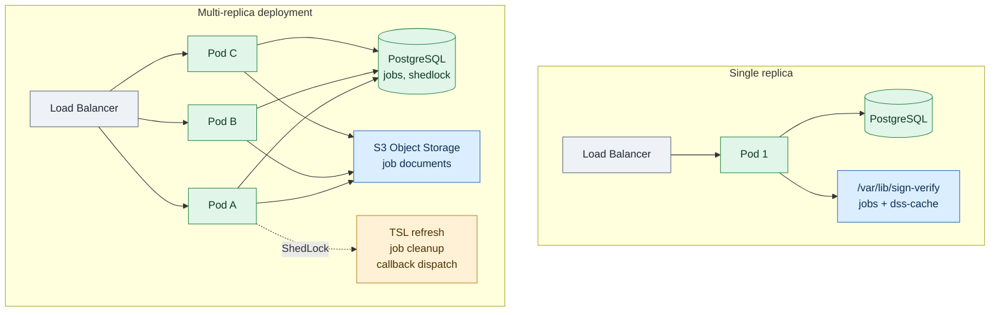
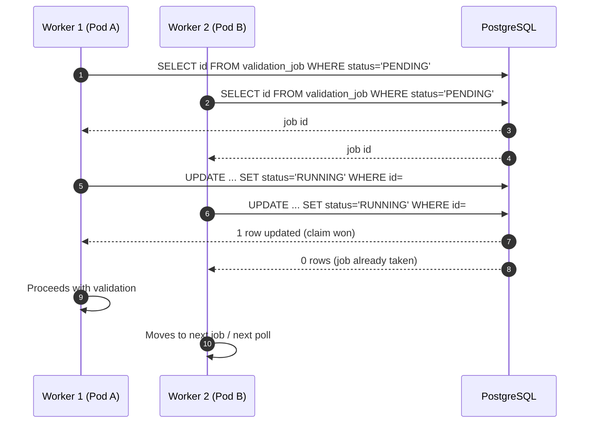

# 7. Horizontal scaling

← [6. Logging and audit](07-logging-audit.md) · [Index](README.md)

The service can be replicated horizontally when the load of async or sync
verifications exceeds the capacity of a single pod. This page describes the
mechanisms that make replication safe and the conditions under which scaling
out is worthwhile.

## 7.1 When a single replica is enough, and when it is not

A single instance handles moderate loads well:

- **Synchronous** verifications are bounded by a semaphore
  (`verify.max-concurrent`, default 8). Throughput is CPU-bound on the DSS
  library: every verification loads certificate chains, CRL/OCSP and TSL data.
- **Async** jobs provide backpressure through `async.max-pending-per-principal`
  and `async.max-pending-global` limits. The client receives 429 when the queue
  is full, so the system does not collapse under spikes.

Horizontal scaling makes sense when:

- the sync semaphore is saturated most of the time and the client cannot
  tolerate waiting;
- the async queue keeps growing despite backpressure;
- fault tolerance is required: if one pod fails, the others continue to serve
  sync verifications and process jobs.

## 7.2 What makes the service horizontally scalable

### Stateless pods

Pods are stateless. The only writable paths under `/var/lib/sign-verify` are:

| Path | Content | Shareable? |
|------|---------|------------|
| `jobs/` | Async job documents (filesystem) | No, local to the pod |
| `dss-cache/` | DSS library cache (TSL, CRL, OCSP) | No, local to the pod |

Shared state lives entirely in **PostgreSQL** (Flyway-managed schema). The
table also includes `shedlock`, used for singleton duties.

### Atomic async job claim

Validation workers do not use a distributed lock. On each poll a worker reads
the ids of `PENDING` jobs and tries to claim them one by one with an atomic
conditional `UPDATE`:

```sql
UPDATE validation_job
SET status = 'RUNNING', started_at = :now, pickup_attempts = pickup_attempts + 1
WHERE id = :id
  AND status = 'PENDING';
```

Only the worker whose `UPDATE` affects one row (returns `1`) proceeds with
validation. If two replicas race for the same job, only one sees the
`status = 'PENDING'` condition satisfied; the others get zero rows and move on
to the next job or the next `poll-interval`.

### Singleton duties protected by ShedLock

Some operations must run on a single pod at a time. The service uses
**ShedLock with a JDBC backend** (`shedlock` table). Configured locks:

| Lock name | Operation | Default schedule |
|-----------|-----------|------------------|
| `tslRefresh` | Trusted Lists refresh | cron `0 0 2 * * *` |
| `jobCleanup` | Expired job and document cleanup | cron `0 30 3 * * *` |
| `callbackDispatch` | HTTP callback dispatch | poll every 10 s |

Only the pod that acquires the lock runs the duty. If the pod dies, the lock
expires after a configured `lockAtMostFor` and another pod picks it up.

### Job document storage: filesystem vs S3

The default backend stores documents on local filesystem
(`APP_STORAGE_JOBS_DIR`). In this mode each pod sees only its own files:
horizontal scaling works only for sync verifications, not for async jobs
(a job created on pod A is not readable from pod B).

To make async jobs horizontally scalable you must enable the **S3** backend:

```yaml
app:
  storage:
    type: s3
    s3:
      endpoint: https://minio.example.org
      region: eu-west-1
      bucket: signverify-jobs
      path-style-access: true   # default false (virtual-hosted, native AWS); true for MinIO/Ceph
```

The corresponding environment variables are `APP_STORAGE_TYPE`,
`APP_STORAGE_S3_ENDPOINT`, `APP_STORAGE_S3_REGION`, `APP_STORAGE_S3_BUCKET` and
`APP_STORAGE_S3_PATH_STYLE`. Credentials are **not** an application property:
the AWS SDK v2 client always uses the **default credentials chain**
(`AWS_ACCESS_KEY_ID`/`AWS_SECRET_ACCESS_KEY` environment variables, IAM
roles/IRSA, profiles), so no secret ever lands in committed configuration.

Object keys are relative:

- `{jobId}/input-{safeName}` for the uploaded document;
- `{jobId}/result.json` for the validation result.

The relative path is stored in the job `document_path` field, so any replica can
resolve and read the document.

At startup the S3 adapter performs a **fail-fast** `headBucket`: if the bucket
is unreachable, the service stops immediately.

### Health checks and load balancing

The load balancer should target two Actuator endpoints:

| Endpoint | Purpose | Response |
|----------|---------|----------|
| `/actuator/health/liveness` | Liveness probe (Kubernetes) | 200 UP if the process is alive |
| `/actuator/health/readiness` | Readiness probe (LB, orchestrator) | 200 UP only when TSL is ready |

Readiness includes `TslReadinessIndicator`: a pod that has not yet completed the
first TSL load is excluded from traffic.

Shutdown is graceful (`server.shutdown: graceful`): on `SIGTERM` the container
completes in-flight requests before exiting.

### Backpressure

Backpressure knobs remain valid across replicas:

| Parameter | Effect |
|-----------|--------|
| `verify.max-concurrent` | Semaphore for sync verifications **per pod** |
| `async.workers` | Polling/claim threads **per pod** |
| `async.max-pending-per-principal` | Per-principal queue limit (global, DB) |
| `async.max-pending-global` | Global queue limit (global, DB) |

Adding replicas multiplies sync throughput and the number of async workers,
but the global pending limits stay unchanged.

### Metrics for autoscaling

Prometheus metrics exposed on `/actuator/prometheus` include:

| Metric | Type | Use |
|--------|------|-----|
| `signverify.async.jobs.pending` | Gauge | Number of pending jobs |
| `signverify.async.jobs.running` | Gauge | Number of running jobs |
| `signverify.storage.s3.operation` | Timer | S3 operation latency |
| `signverify.storage.s3.bytes` | DistributionSummary | S3 byte throughput |

These metrics are suitable for a **HPA** (Horizontal Pod Autoscaler) on
Kubernetes: you can scale on `pending jobs` or on S3 latency.

## 7.3 Honest limitations

The DSS cache (`dss-cache/`) remains **per-pod**. TSL refresh runs on a single
pod via ShedLock. Validation correctness does not depend on a shared cache:
every replica can download TSL, CRL and OCSP independently. However, a freshly
created pod pays a **warm-up** penalty on the first verification because its
cache is empty. In practice this means higher latency for the first requests
after a rollout or pod restart.

## 7.4 Runbook: switching from filesystem to S3

Filesystem and S3 do not mix:

- filesystem stores **absolute paths** local to the pod;
- S3 stores **relative keys** in the bucket.

There is no automatic document migration. The recommended procedure:

1. **Stop submissions**: stop accepting new jobs (or put the `/jobs` endpoint
   in maintenance).
2. **Drain the queue**: wait for all `PENDING`/`RUNNING` jobs to reach a
   terminal state.
3. **Configure S3**: export `APP_STORAGE_TYPE=s3` and the `APP_STORAGE_S3_*`
   variables, with the bucket provisioned and credentials in the SDK default
   chain (IAM/IRSA or env).
4. **Roll out**: restart all pods. New jobs will use S3; old filesystem jobs
   are no longer referenced and are removed by the cleanup (`jobCleanup`) as
   retentions expire.

## 7.5 Diagrams

### Single-replica vs multi-replica deployment



### Atomic job claim



## 7.6 Scale-out prerequisites

Before adding replicas in production, verify this checklist:

- [ ] **S3 enabled**: `APP_STORAGE_TYPE=s3` and all `APP_STORAGE_S3_*`
  variables configured, with the bucket reachable.
- [ ] **External PostgreSQL**: a managed database, not in-memory H2; the
  connection must support the intended number of replicas.
- [ ] **Load balancer on readiness**: the LB must use
  `/actuator/health/readiness` to exclude not-ready pods.
- [ ] **Resource limits**: each replica has a significant CPU/memory footprint
  because of DSS; set adequate `requests` and `limits`.
- [ ] **Shared master key**: identical `APP_SECRET_MASTER_KEY` on all pods
  (passed via env/secrets, not generated locally).
