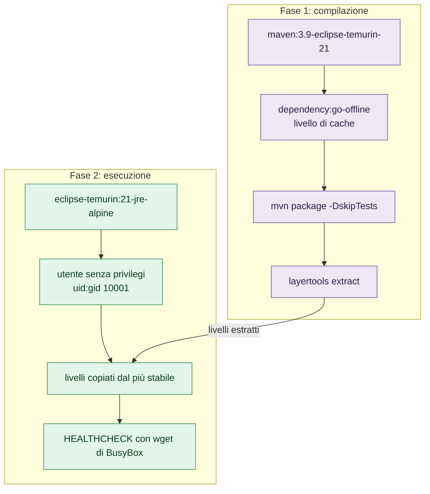
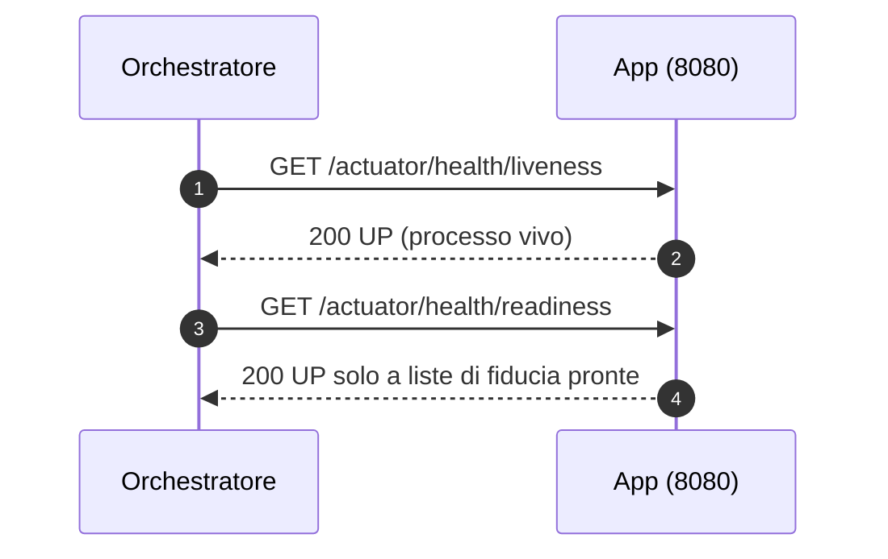
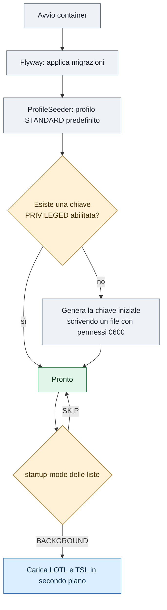

# 1b. Docker e configurazione

← [1. Compilazione e configurazione](01-build-configurazione.md) · [Indice](README.md) · → [2. Autenticazione](03-autenticazione.md)

Il servizio viene distribuito come immagine Docker
**[`toresoft/sign-verify`](https://hub.docker.com/r/toresoft/sign-verify)**,
pubblicata su Docker Hub. L'immagine è costruita con un `Dockerfile` a più fasi
e gira su una base **Alpine** irrobustita, senza privilegi di root.

> **Serve una guida passo passo?** Vedi la [Guida operativa Docker](02b-guida-operativa-docker.md), che accompagna dalla prima esecuzione fino alla produzione.

```bash
docker pull toresoft/sign-verify:latest
```

## 2.1 Anatomia dell'immagine



Caratteristiche di sicurezza del `Dockerfile`:

- **Base Alpine** (`eclipse-temurin:21-jre-alpine`): superficie d'attacco e
  numero di vulnerabilità note molto inferiori rispetto a una base Ubuntu/glibc.
- **Utente senza privilegi di root**, `uid:gid = 10001:10001`, dichiarato in
  forma numerica così che gli orchestratori possano imporre `runAsNonRoot`.
- **HEALTHCHECK** con il `wget` di BusyBox, senza installare pacchetti aggiuntivi.
- **Jar a livelli**, estratto con `layertools`: i livelli più stabili, cioè le
  dipendenze, vengono prima, e la cache viene riusata più spesso.
- Avvio in **exec form** → l'applicazione è il processo 1 e riceve `SIGTERM` per
  l'arresto controllato (`server.shutdown: graceful`).
- `JAVA_TOOL_OPTIONS=-XX:MaxRAMPercentage=75.0 -XX:+ExitOnOutOfMemoryError`;
  JDK 21 rispetta i limiti cgroup (`UseContainerSupport`).

L'immagine espone la porta **8080** e crea l'unica directory scrivibile,
`/var/lib/sign-verify`, di cui è proprietaria (con le sottodirectory
`dss-cache` e `jobs`).

## 2.2 Sviluppo locale: `docker-compose.yml`

Ambiente di sviluppo: il servizio, compilato dai sorgenti, più PostgreSQL 16.

```bash
docker compose up --build

# La prima accensione scrive la chiave API di bootstrap nel volume svdata:
docker compose exec app cat /var/lib/sign-verify/bootstrap-api-key.txt
```

Configurazione applicata (profilo `docker`):

| Variabile | Valore |
|-----------|--------|
| `SPRING_PROFILES_ACTIVE` | `docker` |
| `SPRING_DATASOURCE_URL` | `jdbc:postgresql://postgres:5432/signverify` |
| `SPRING_DATASOURCE_USERNAME` / `PASSWORD` | `signverify` / `signverify` |

> Nel profilo `docker` OAuth è disabilitato e l'aggiornamento delle liste di
> fiducia è **saltato** (`startup-mode: SKIP`), così si può sviluppare senza
> rete. La chiave master è un valore di prova: **non usarla in produzione**.

Volumi: `pgdata` per i dati di Postgres e `svdata` per `/var/lib/sign-verify`.

## 2.3 Produzione: `docker-compose.prod.yml`

Esegue l'immagine pubblicata e si aspetta un **PostgreSQL esterno gestito**.

```bash
# Impostare le variabili in un file .env (vedi .env.example), poi:
docker compose -f docker-compose.prod.yml up -d
```

Misure di irrobustimento applicate al container:

| Direttiva | Valore | Effetto |
|-----------|--------|---------|
| `read_only` | `true` | filesystem radice immutabile |
| `tmpfs` | `/tmp:size=128m,mode=1777` | spazio di lavoro temporaneo per i caricamenti multipart |
| `security_opt` | `no-new-privileges:true` | impedisce l'acquisizione di nuovi privilegi |
| `cap_drop` | `ALL` | rimuove tutte le capacità (capability) Linux |
| `volumes` | `svdata:/var/lib/sign-verify` | unico percorso persistente scrivibile |
| `deploy.resources.limits` | `memory 1g`, `cpus 2.0` | limiti di risorse |
| `logging` | `json-file`, `max-size 10m`, `max-file 3` | rotazione dei log del container |

Variabili d'ambiente richieste in produzione:

```bash
# Database (esterno/gestito)
SPRING_DATASOURCE_URL=jdbc:postgresql://db.example.org:5432/signverify
SPRING_DATASOURCE_USERNAME=signverify
SPRING_DATASOURCE_PASSWORD=********
# Segreti e autenticazione
APP_SECRET_MASTER_KEY=<base64 32 byte>
APP_SECURITY_OAUTH_ISSUER_URI=https://idp.example.org/...   # se OAuth è attivo
APP_OJ_KEYSTORE_PASSWORD=<password keystore OJ>
```

> Nota: `docker-compose.prod.yml` non imposta `SPRING_PROFILES_ACTIVE`, quindi
> vale il profilo **di produzione** (OAuth abilitato, aggiornamento delle liste
> di fiducia in modalità `BACKGROUND`).

## 2.4 Memorizzazione dei documenti: volume locale, MinIO o S3 gestito

I documenti dei job possono essere conservati in tre modi:

1. **Volume locale `svdata`** (predefinito): adatto solo a installazioni con una
   sola replica; i file risiedono in `/var/lib/sign-verify/jobs`.
2. **Archivio a oggetti compatibile S3**: per installazioni con più repliche, dove
   i documenti devono essere accessibili da tutte le istanze. Richiede
   `APP_STORAGE_TYPE=s3` e le variabili di connessione (vedi
   [1.4](01-build-configurazione.md#memorizzazione-dei-documenti-e-dss)).
3. **MinIO come container Docker**: quando non si dispone di un servizio S3
   gestito, cioè per lo sviluppo locale sul percorso di codice S3, per gli
   ambienti di integrazione continua e di dimostrazione, per le installazioni
   presso il cliente o su nodi periferici senza archivio a oggetti in cloud e per
   quelle isolate dalla rete. Da evitare in produzione su volumi importanti:
   meglio un servizio S3 gestito, che offre durabilità, gestione operativa e alta
   disponibilità, oppure un cluster MinIO amministrato come si deve, non un
   singolo container di compose.

Esempio di servizio MinIO aggiunto a `docker-compose.yml`:

```yaml
  minio:
    image: pgsty/minio:RELEASE.2026-06-18T00-00-00Z
    ports:
      - "9000:9000"
      - "9001:9001"
    environment:
      MINIO_ROOT_USER: minioadmin
      MINIO_ROOT_PASSWORD: minioadmin
    volumes:
      - miniodata:/data
    command: server /data --console-address ":9001"

volumes:
  miniodata:
```

Configurazione lato applicazione, da aggiungere alla sezione `environment` del
servizio `app`:

```yaml
      APP_STORAGE_TYPE: s3
      APP_STORAGE_S3_ENDPOINT: http://minio:9000
      APP_STORAGE_S3_REGION: us-east-1
      APP_STORAGE_S3_BUCKET: sign-verify-jobs
      APP_STORAGE_S3_PATH_STYLE: "true"
      # Credenziali dalla catena predefinita dell'SDK: nessuna proprietà app.storage.s3.* contiene segreti
      AWS_ACCESS_KEY_ID: minioadmin
      AWS_SECRET_ACCESS_KEY: minioadmin
```

> Il bucket `sign-verify-jobs` va creato una volta sola, per esempio con il client
> `mc` o con un job usa e getta che invochi `create-bucket`: l'applicazione esegue
> `headBucket` all'avvio e si arresta se il bucket non esiste.

## 2.5 Salute e prontezza



- **Vitalità**, `/actuator/health/liveness`: usata dall'`HEALTHCHECK`
  dell'immagine di sviluppo.
- **Prontezza**, `/actuator/health/readiness`: usata da
  `docker-compose.prod.yml`; tiene conto del caricamento delle liste di fiducia
  (`TslReadinessIndicator`).

Endpoint `actuator` esposti: `health`, `info`, `metrics`, `prometheus`.
Sono pubblici, cioè raggiungibili senza autenticazione, solo `health/**` e
`prometheus`; `info` richiede autenticazione. Su `health` i chiamanti anonimi
vedono solo lo `status` complessivo, mentre i dettagli dei singoli componenti
richiedono un chiamante PRIVILEGED.

## 2.6 Primo avvio



Al primo avvio, se non esiste alcuna chiave `PRIVILEGED` abilitata, il servizio
genera una **chiave API di bootstrap** e la scrive nel file indicato da
`APP_SECURITY_BOOTSTRAP_KEY_FILE` (permessi `0600`). Recuperarla, usarla per
creare le proprie chiavi, quindi **eliminare il file**. Dettagli in
[3. Autenticazione](03-autenticazione.md).
