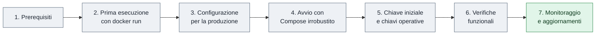

# Guida operativa passo passo: immagine Docker

← [1b. Docker e configurazione](02-docker.md) · [Indice](README.md)

Questa guida accompagna dall'installazione fino alla messa in produzione
dell'immagine **`toresoft/sign-verify`**, distribuita su Docker Hub. Non serve
clonare il repository: si parte dall'immagine già pronta.

Per i dettagli tecnici dell'immagine, cioè com'è fatta, come è stata
irrobustita e quali profili Spring usa, si rimanda alla
[documentazione di riferimento](02-docker.md).

---

## Panoramica del percorso



---

## Passo 1: Prerequisiti

| Requisito | Versione | Note |
|-----------|----------|------|
| Docker Engine | 20.10+ | Compose V2 incluso |
| PostgreSQL | 16 (gestito) | Istanza esterna raggiungibile dal container |
| `openssl` | qualunque | Per generare la chiave master |
| `curl` | qualunque | Per verificare l'API e recuperare la chiave iniziale |

Verificare Docker:

```bash
docker compose version
# Docker Compose version v2.XX.X
```

Verificare che PostgreSQL sia raggiungibile:

```bash
psql -h db.example.internal -U signverify -d signverify -c 'SELECT 1'
```

> L'immagine non include un database: serve un **PostgreSQL esterno**, gestito,
> in cloud o presso il cliente. L'ambiente di sviluppo con il database incluso
> esiste solo nel repository dei sorgenti.

---

## Passo 2: Prima esecuzione con `docker run`

Per una prova rapida si può avviare l'immagine direttamente con `docker run`.
Questa modalità **non** va bene in produzione, perché salta tutte le misure di
irrobustimento, ma basta a verificare che l'immagine funzioni.

### 2.1 Scaricare l'immagine

```bash
docker pull toresoft/sign-verify:latest
```

Tag disponibili:

| Tag | Significato |
|-----|-------------|
| `latest` | Ultima immagine costruita dal ramo principale |
| `<versione>` | Versione rilasciata, per esempio `0.9.21` |
| `<short-sha>` | Immagine costruita da un commit specifico |

### 2.2 Avviare il container per una prova rapida

```bash
docker run -d --name sign-verify \
  -p 8080:8080 \
  -e SPRING_DATASOURCE_URL=jdbc:postgresql://db.example.internal:5432/signverify \
  -e SPRING_DATASOURCE_USERNAME=signverify \
  -e SPRING_DATASOURCE_PASSWORD=secret \
  -e APP_SECRET_MASTER_KEY="$(openssl rand -base64 32)" \
  -e APP_SECURITY_OAUTH_ENABLED=false \
  -v svdata:/var/lib/sign-verify \
  toresoft/sign-verify:latest
```

> Se non si ha un database PostgreSQL esterno immediatamente disponibile,
> è possibile usare un'istanza temporanea Docker:
>
> ```bash
> docker run -d --name sv-postgres \
>   -e POSTGRES_DB=signverify \
>   -e POSTGRES_USER=signverify \
>   -e POSTGRES_PASSWORD=signverify \
>   -p 5432:5432 \
>   postgres:16-alpine
> ```
>
> A questo punto si usa
> `SPRING_DATASOURCE_URL=jdbc:postgresql://sv-postgres:5432/signverify` (su un
> host Linux con una rete Docker) oppure si punta a `localhost:5432`.

### 2.3 Verificare che il servizio risponda

```bash
# Vitalità: il processo è vivo
curl -sS http://localhost:8080/actuator/health/liveness | jq .
# → { "status": "UP" }

# Prontezza: il servizio è pronto, liste di fiducia comprese
curl -sS http://localhost:8080/actuator/health/readiness | jq .
# → { "status": "UP" }  (al primo avvio può richiedere alcuni minuti)
```

### 2.4 Fermare e rimuovere il container di prova

```bash
docker stop sign-verify && docker rm sign-verify
docker volume rm svdata   # facoltativo: cancella i dati della prova
```

---

## Passo 3: Configurazione per la produzione

Per la produzione si usa `docker-compose.prod.yml`, un file Compose con tutte le
misure di irrobustimento. Il contenuto completo è riportato più sotto, così non
serve clonare il repository.

### 3.1 Creare la directory di lavoro

```bash
mkdir sign-verify && cd sign-verify
```

### 3.2 Creare il file `.env`

Generare la chiave master:

```bash
openssl rand -base64 32
# es. output: "dG9yZXNvZnQtc2lnbi12ZXJpZnktMjU2Yml0LWtleQ=="
```

Creare `.env` con i valori reali:

```bash
cat > .env << 'EOF'
# === Versione dell'immagine (fissarla per installazioni riproducibili) ===
SIGN_VERIFY_VERSION=0.9.21

# === Database esterno (obbligatorio) ===
SPRING_DATASOURCE_URL=jdbc:postgresql://db.example.internal:5432/signverify
SPRING_DATASOURCE_USERNAME=signverify
SPRING_DATASOURCE_PASSWORD=<password-sicura>

# === Segreti (obbligatori) ===
# Chiave master: base64 di 32 byte casuali (generare con: openssl rand -base64 32)
APP_SECRET_MASTER_KEY=<incollare-loutput-di-openssl-rand>

# === Autenticazione OAuth (se serve) ===
# Se OAuth è abilitato, com'è in produzione, indicare l'issuer OIDC:
APP_SECURITY_OAUTH_ISSUER_URI=https://idp.example.com/realms/signverify
# Per disabilitare OAuth, per esempio in prova: APP_SECURITY_OAUTH_ENABLED=false

# === Keystore OJ (se serve) ===
# Password del keystore incluso nell'immagine, usato per la LOTL europea
APP_OJ_KEYSTORE_PASSWORD=<password-keystore-oj>

# === Sentry (facoltativo: lasciare SENTRY_DSN vuoto per disattivarlo) ===
SENTRY_DSN=
SENTRY_ENVIRONMENT=production
SENTRY_RELEASE=                 # vuoto = la ricava l'SDK; oppure il tag git
SENTRY_BREADCRUMB_LEVEL=INFO    # INFO / WARN / ERROR
EOF
```

> **Attenzione:** il file `.env` non va mai versionato. Se si lavora dal
> repository è già in `.gitignore`, ma resta comunque un file da proteggere come
> un segreto.

### 3.3 Creare `docker-compose.prod.yml`

Salvare il seguente file come `docker-compose.prod.yml` nella directory di
lavoro:

```yaml
# Produzione: immagine da Docker Hub, con tutte le misure di irrobustimento.
# Richiede un PostgreSQL ESTERNO gestito (variabili nel file .env).
#
#   docker compose -f docker-compose.prod.yml up -d
name: sign-verify

services:
  app:
    # Fissare la versione in .env: installazioni riproducibili e ritorno a una versione precisa.
    image: toresoft/sign-verify:${SIGN_VERIFY_VERSION:-latest}
    restart: unless-stopped
    environment:
      # --- Database (esterno/gestito) ---
      SPRING_DATASOURCE_URL: ${SPRING_DATASOURCE_URL}
      SPRING_DATASOURCE_USERNAME: ${SPRING_DATASOURCE_USERNAME}
      SPRING_DATASOURCE_PASSWORD: ${SPRING_DATASOURCE_PASSWORD}
      # --- Segreti e autenticazione ---
      APP_SECRET_MASTER_KEY: ${APP_SECRET_MASTER_KEY}
      APP_SECURITY_OAUTH_ISSUER_URI: ${APP_SECURITY_OAUTH_ISSUER_URI}
      APP_OJ_KEYSTORE_PASSWORD: ${APP_OJ_KEYSTORE_PASSWORD}
      # --- Monitoraggio (facoltativo) ---
      SENTRY_DSN: ${SENTRY_DSN:-}
      SENTRY_ENVIRONMENT: ${SENTRY_ENVIRONMENT:-production}
      SENTRY_RELEASE: ${SENTRY_RELEASE:-}
    ports:
      - "8080:8080"
    # --- Irrobustimento ---
    read_only: true                 # filesystem radice immutabile
    tmpfs:
      - /tmp:size=128m,mode=1777    # spazio temporaneo per i caricamenti multipart
    security_opt:
      - no-new-privileges:true       # impedisce di acquisire nuovi privilegi (setuid)
    cap_drop:
      - ALL                          # rimuove tutte le capacità (capability) Linux
    volumes:
      - svdata:/var/lib/sign-verify  # unico percorso persistente scrivibile
    deploy:
      resources:
        limits:
          memory: 1g
          cpus: "2.0"
    healthcheck:
      test: ["CMD", "wget", "-q", "-O", "/dev/null",
             "http://localhost:8080/actuator/health/readiness"]
      interval: 30s
      timeout: 5s
      retries: 3
      start_period: 120s
    logging:
      driver: json-file
      options:
        max-size: "10m"
        max-file: "3"

volumes:
  svdata:
```

### 3.4 Irrobustimento del container: riepilogo

Il file Compose sopra applica:

| Direttiva | Valore | Effetto |
|-----------|--------|---------|
| `read_only` | `true` | Filesystem radice immutabile |
| `tmpfs` | `/tmp:size=128m,mode=1777` | Spazio temporaneo per i caricamenti multipart |
| `security_opt` | `no-new-privileges:true` | Impedisce di acquisire nuovi privilegi |
| `cap_drop` | `ALL` | Rimuove tutte le capacità (capability) Linux |
| `volumes` | `svdata:/var/lib/sign-verify` | Unico percorso persistente scrivibile |
| `deploy.resources.limits` | 1 GB di memoria, 2 CPU | Limiti di risorsa |
| `logging` | `json-file`, 10 MB × 3 | Rotazione dei log del container |
| `healthcheck` | `wget` su `/readiness` | Controllo di salute periodico |

Il container gira con un utente senza privilegi di root (`uid:gid 10001:10001`).

---

## Passo 4: Avvio con il Compose irrobustito

### 4.1 Avviare il servizio

```bash
docker compose -f docker-compose.prod.yml up -d
```

Docker scarica l'immagine da solo la prima volta, e ogni volta che
`SIGN_VERIFY_VERSION` cambia.

### 4.2 Verificare che il container sia partito

```bash
docker compose -f docker-compose.prod.yml ps
docker compose -f docker-compose.prod.yml logs --tail=50 app
```

### 4.3 Verificare la prontezza

```bash
curl -sS http://localhost:8080/actuator/health/readiness | jq .
# → { "status": "UP", "components": { "readinessState": { "status": "UP" } } }
```

Al primo avvio lo scaricamento delle liste di fiducia europee può richiedere
alcuni minuti. La **vitalità** risulta subito `UP`, perché il processo è vivo,
mentre la **prontezza** passa a `UP` solo a caricamento finito.

### 4.4 Instradamento tramite proxy inverso

L'immagine non include un proxy inverso. In produzione se ne mette uno davanti
al container, per esempio Nginx, Traefik o HAProxy, eventualmente insieme a un
bilanciatore di carico:

```
Internet → [Proxy inverso :443 → localhost:8080] → Container
```

Impostazioni consigliate per il proxy:

- Terminazione TLS sul proxy inverso.
- Header `X-Forwarded-Proto: https`, così Spring genera URL corretti.
- Tempi di attesa abbastanza lunghi per le richieste di verifica asincrona: i
  job vengono elaborati a parte, quindi la risposta iniziale è immediata.
- Dimensione massima del corpo della richiesta di almeno 60 MB
  (`client_max_body_size` in Nginx).

Se il proxy inoltra quegli header, aggiungere in `.env`:

```bash
SERVER_FORWARD_HEADERS_STRATEGY=native
```

---

## Passo 5: Chiave iniziale e chiavi operative

Al primo avvio, se non esiste alcuna chiave `PRIVILEGED` abilitata, il servizio
genera una **chiave iniziale** e la scrive nel file
`/var/lib/sign-verify/bootstrap-api-key.txt` (permessi `0600`).

### 5.1 Recuperare la chiave iniziale

```bash
BOOTSTRAP_KEY=$(docker compose -f docker-compose.prod.yml exec -T app \
  cat /var/lib/sign-verify/bootstrap-api-key.txt)
echo "Chiave iniziale: $BOOTSTRAP_KEY"
```

### 5.2 Creare chiavi operative

La chiave iniziale serve solo a creare le chiavi operative. Se ne creino almeno
due, una `PRIVILEGED` e una `STANDARD`:

```bash
# Chiave amministrativa (PRIVILEGED)
curl -sS -X POST http://localhost:8080/api/v1/api-keys \
  -H "X-API-Key: $BOOTSTRAP_KEY" \
  -H "Content-Type: application/json" \
  -d '{"name":"admin-prod","role":"PRIVILEGED"}' | jq .

# Chiave per i client (STANDARD), con scadenza facoltativa
curl -sS -X POST http://localhost:8080/api/v1/api-keys \
  -H "X-API-Key: $BOOTSTRAP_KEY" \
  -H "Content-Type: application/json" \
  -d '{"name":"ci-pipeline","role":"STANDARD","expiresAt":"2027-01-01T00:00:00Z"}' | jq .
```

La risposta `201` contiene `plaintextKey`: il valore in chiaro viene restituito
una sola volta soltanto. Va conservato in un gestore di segreti.

### 5.3 Eliminare il file della chiave iniziale

```bash
docker compose -f docker-compose.prod.yml exec app \
  rm /var/lib/sign-verify/bootstrap-api-key.txt
```

> Il servizio impedisce di disabilitare o eliminare l'**ultima** chiave
> `PRIVILEGED` abilitata, per non restare chiusi fuori: l'operazione dà 409.

Per approfondire: [Autenticazione](03-autenticazione.md).

---

## Passo 6: Verifiche funzionali dopo l'installazione

### 6.1 Verificare l'autenticazione

```bash
# Elenco delle chiavi (richiede il ruolo PRIVILEGED)
curl -sS http://localhost:8080/api/v1/api-keys \
  -H "X-API-Key: $BOOTSTRAP_KEY" | jq .
```

### 6.2 Verificare una firma digitale, in modo sincrono

```bash
# Richiede una chiave con ruolo STANDARD o PRIVILEGED
curl -sS -X POST http://localhost:8080/api/v1/verifications \
  -H "X-API-Key: $API_KEY" \
  -F file=@documento.pdf.p7m \
  | jq .
```

### 6.3 Verificare le liste di fiducia

```bash
# Aggiornamento manuale (richiede il ruolo PRIVILEGED)
curl -sS -X POST http://localhost:8080/api/v1/tsl/refresh \
  -H "X-API-Key: $PRIVILEGED_KEY" | jq .

# Stato delle liste di fiducia
curl -sS http://localhost:8080/api/v1/tsl/status \
  -H "X-API-Key: $API_KEY" | jq .
```

### 6.4 Verificare la documentazione interattiva

Aprire nel browser `http://localhost:8080/swagger-ui/index.html`.

La specifica OpenAPI è disponibile su `http://localhost:8080/v3/api-docs`.

---

## Passo 7: Monitoraggio e manutenzione

### 7.1 Endpoint Actuator

| Endpoint | Autenticazione | Scopo |
|----------|---------------|-------|
| `/actuator/health/liveness` | nessuna | Il processo è vivo (Kubernetes `livenessProbe`) |
| `/actuator/health/readiness` | nessuna | Il servizio è pronto, liste di fiducia comprese (`readinessProbe`) |
| `/actuator/health` | nessuna per lo stato, PRIVILEGED per i dettagli | Stato complessivo; i dettagli dei singoli componenti (liste di fiducia, coda dei job, database, disco) solo per un chiamante PRIVILEGED |
| `/actuator/info` | **PRIVILEGED** | Versione compilata e dati di git; non è più pubblico |
| `/actuator/prometheus` | nessuna | Metriche Prometheus |

Gli altri endpoint (`metrics`, `env`, `beans` e simili) **non sono pubblici** e
richiedono autenticazione.

### 7.2 Controllare la salute del container

```bash
# Stato di salute secondo docker inspect, in formato leggibile
docker inspect --format='{{json .State.Health}}' sign-verify-app-1 | jq .

# Controllo rapido con curl
curl -sfS http://localhost:8080/actuator/health | jq .status
# "UP"

# Solo la prontezza, che comprende lo stato delle liste di fiducia
curl -sS http://localhost:8080/actuator/health/readiness | jq .
```

### 7.3 Log applicativi

I log escono sullo standard output, in JSON strutturato tramite Logback. Con
Docker Compose:

```bash
# Ultime 100 righe di log del container
docker compose -f docker-compose.prod.yml logs --tail=100 app

# Seguire in tempo reale
docker compose -f docker-compose.prod.yml logs -f app
```

Il livello di log si cambia senza ricompilare, con una variabile d'ambiente:
per esempio `LOGGING_LEVEL_ORG_TORESOFT_SIGNVERIFY=DEBUG` in `.env`.

### 7.4 Sentry (facoltativo)

Sentry è **del tutto facoltativo**: se `SENTRY_DSN` è vuoto, come da impostazione
iniziale, l'SDK non invia nulla e non pesa in alcun modo.

Per attivarlo, aggiungere in `.env`:

```bash
SENTRY_DSN=https://xxxxx@o123456.ingest.sentry.io/7654321
SENTRY_ENVIRONMENT=production
SENTRY_RELEASE=0.9.21           # tag git, per collegare gli errori alla versione
SENTRY_BREADCRUMB_LEVEL=INFO    # livello minimo degli eventi di contesto
```

Comportamento:
- Gli errori dovuti al chiamante (4xx, `AppException` con stato minore di 500)
  vengono **scartati** e non creano segnalazioni su Sentry.
- Gli errori del servizio (5xx, `AppException` con stato da 500 in su) vengono
  segnalati.
- `send-default-pii: false`, per non inviare dati personali (GDPR).
- Gli eventi di contesto vengono raccolti a partire dal livello impostato in
  `SENTRY_BREADCRUMB_LEVEL`.

### 7.5 Aggiornamenti

**Fissare sempre il tag dell'immagine** in `.env`:

```bash
SIGN_VERIFY_VERSION=0.9.21   # In produzione non usare :latest
```

Aggiornamento:

```bash
# 1. Modificare la versione in .env
sed -i 's/^SIGN_VERIFY_VERSION=.*/SIGN_VERIFY_VERSION=0.9.22/' .env

# 2. Scaricare la nuova immagine
docker compose -f docker-compose.prod.yml pull app

# 3. Riavviare con la nuova immagine
docker compose -f docker-compose.prod.yml up -d app
```

Ritorno alla versione precedente:

```bash
sed -i 's/^SIGN_VERIFY_VERSION=.*/SIGN_VERIFY_VERSION=0.9.21/' .env
docker compose -f docker-compose.prod.yml pull app
docker compose -f docker-compose.prod.yml up -d app
```

> Se una migrazione Flyway ha cambiato lo schema in modo non compatibile con la
> versione precedente, tornare indietro può richiedere il ripristino di una
> copia di sicurezza del database. Leggere le note di rilascio prima di
> aggiornare.

### 7.6 Copie di sicurezza

| Dove | Contenuto | Come proteggerlo |
|------|-----------|------------------|
| PostgreSQL (esterno) | Schema, chiavi API, job, audit | Copia di sicurezza gestita, per esempio con `pg_dump` |
| `/var/lib/sign-verify/` (`svdata`) | Cache DSS, file temporanei dei job | Volume Docker; sono dati ricreabili |

Il volume `svdata` contiene la cache di DSS e i file temporanei dei job. Se
viene cancellato il servizio lo ricrea: riscarica le liste di fiducia e svuota i
job ancora in attesa, che risultano scaduti.

---

## Risoluzione dei problemi

### Il container non parte o si riavvia di continuo

```bash
docker compose -f docker-compose.prod.yml logs app | tail -100
```

Cause comuni:

| Sintomo | Causa probabile | Risoluzione |
|---------|-----------------|-------------|
| `ExitOnOutOfMemoryError` | Memoria della JVM esaurita | Aumentare il limite `memory` nel file Compose oppure `-XX:MaxRAMPercentage` |
| `Flyway migration failed` | Schema incompatibile | Controllare la versione del database e le migrazioni |
| Password rifiutata dal database | Credenziali errate | Verificare le `SPRING_DATASOURCE_*` in `.env` |
| `APP_SECRET_MASTER_KEY` mancante | Variabile non impostata | Generare e impostare in `.env` |
| `APP_SECRET_MASTER_KEY` vuoto o non valido | Codifica base64 non valida | Rigenerare con `openssl rand -base64 32` |

### La prontezza resta `DOWN`

Al primo avvio le liste di fiducia vengono scaricate in secondo piano. Se il
container non raggiunge `ec.europa.eu`, la prontezza non passa mai a `UP`.

Verificare il collegamento:

```bash
docker compose -f docker-compose.prod.yml exec app \
  wget -q -O- https://ec.europa.eu/tools/lotl/eu-lotl.xml | head -5
```

### Errore 401 su tutte le richieste

- Verificare che l'header sia `X-API-Key` (non `Authorization`).
- Verificare che la chiave non sia scaduta (`expiresAt`).
- Se OAuth è abilitato e l'issuer non è raggiungibile, tutte le richieste con
  JWT falliscono: in quel caso si può ripiegare su una API key valida.

### Pulire e ripartire da zero

```bash
docker compose -f docker-compose.prod.yml down -v   # cancella container e volumi
docker compose -f docker-compose.prod.yml up -d     # ricrea tutto
```

> **Attenzione:** `down -v` cancella il volume locale `svdata`, cioè la cache di
> DSS e i file temporanei, ma non tocca il PostgreSQL esterno: i dati salvati sul
> database restano intatti.

---

## Variabili d'ambiente: riferimento rapido

### Obbligatorie in produzione

| Variabile | Descrizione | Esempio |
|-----------|-------------|---------|
| `SPRING_DATASOURCE_URL` | URL JDBC del database | `jdbc:postgresql://db:5432/signverify` |
| `SPRING_DATASOURCE_USERNAME` | Utente del database | `signverify` |
| `SPRING_DATASOURCE_PASSWORD` | Password del database | n/d |
| `APP_SECRET_MASTER_KEY` | Chiave di cifratura, base64 di 32 byte | l'output di `openssl rand -base64 32` |

### Necessarie in certi casi

| Variabile | Quando serve | Predefinito |
|-----------|--------------|-------------|
| `APP_SECURITY_OAUTH_ISSUER_URI` | Se OAuth è abilitato, come avviene normalmente | vuoto |
| `APP_SECURITY_OAUTH_ENABLED` | Per disabilitare OAuth in produzione | `true` |
| `APP_OJ_KEYSTORE_PASSWORD` | Per scaricare le liste di fiducia europee | vuoto |

### Facoltative

| Variabile | Descrizione | Predefinito |
|-----------|-------------|-------------|
| `SIGN_VERIFY_VERSION` | Tag dell'immagine Docker | `latest` |
| `SERVER_PORT` | Porta HTTP del container | `8080` |
| `SENTRY_DSN` | Indirizzo del progetto Sentry; vuoto = disattivato | vuoto |
| `SENTRY_ENVIRONMENT` | Ambiente dichiarato a Sentry | `development` |
| `SENTRY_RELEASE` | Versione dichiarata a Sentry; vuoto = la ricava l'SDK | vuoto |
| `SENTRY_BREADCRUMB_LEVEL` | Livello minimo degli eventi di contesto (INFO/WARN/ERROR) | `INFO` |
| `APP_STORAGE_JOBS_DIR` | Directory dei file temporanei dei job | `/var/lib/sign-verify/jobs` |
| `APP_DSS_CACHE_DIR` | Directory della cache di DSS | `/var/lib/sign-verify/dss-cache` |

Per l'elenco completo dei parametri, vedi
[1. Compilazione e configurazione](01-build-configurazione.md).

---

## Controlli prima di andare in produzione

Prima di esporre il servizio, verificare che:

- [ ] `SIGN_VERIFY_VERSION` sia fissato a un tag preciso, non a `latest`
- [ ] il file `.env` contenga password robuste e non sia accessibile a tutti
- [ ] `APP_SECRET_MASTER_KEY` sia stato generato con `openssl rand -base64 32`
- [ ] il proxy inverso termini il TLS e imposti `X-Forwarded-Proto: https`
- [ ] la chiave iniziale sia servita a creare le chiavi operative e sia poi stata eliminata
- [ ] la prontezza sia passata a `UP`, cioè le liste di fiducia siano state scaricate
- [ ] le misure di irrobustimento del container siano attive (`read_only`, `cap_drop: ALL` e le altre)
- [ ] `SENTRY_DSN` sia impostato, oppure lasciato vuoto di proposito
- [ ] il livello di log sia adatto alla produzione (`INFO`)
- [ ] sia configurata la copia di sicurezza del database PostgreSQL
