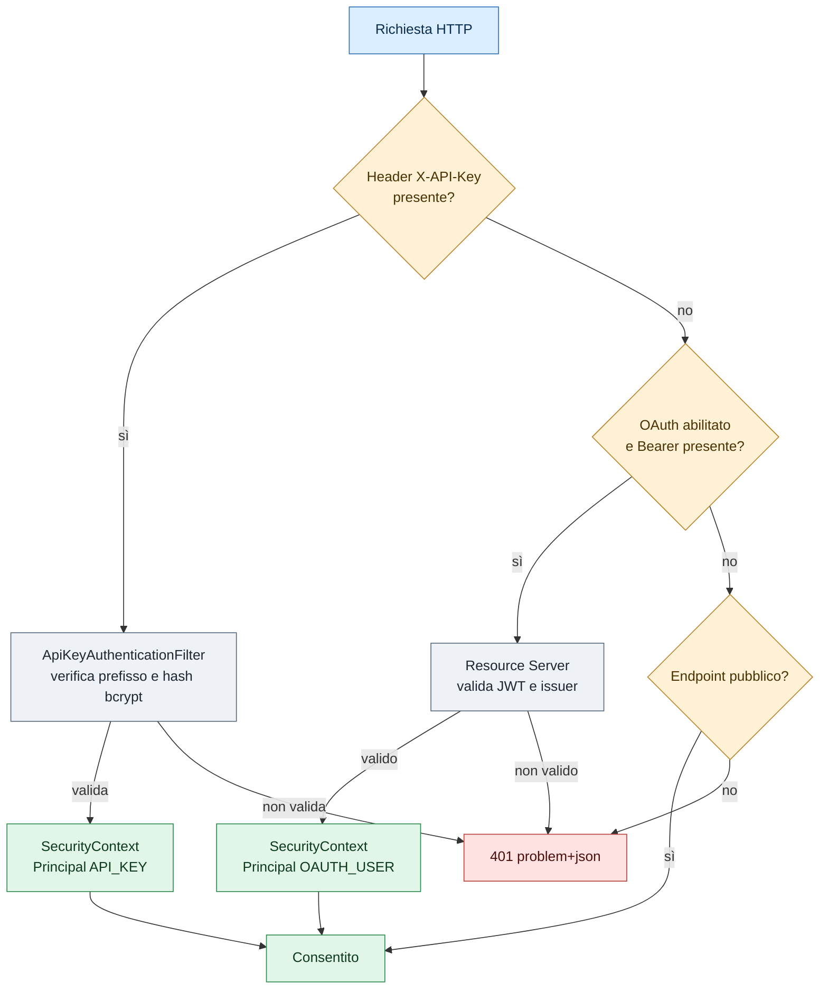
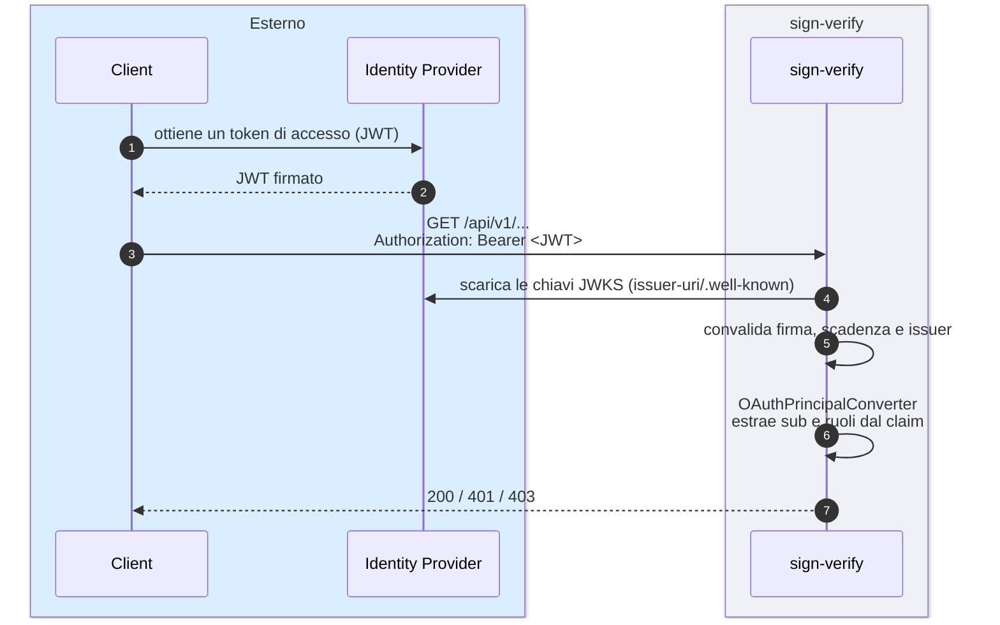

# 2. Autenticazione e autorizzazione

← [1b. Docker e configurazione](02-docker.md) · [Indice](README.md) · → [3. API dei certificati di fiducia](04-trusted-certificates.md)

- [2.1 Panoramica](#21-panoramica)
- [2.2 Uso delle API key](#22-uso-delle-api-key)
- [2.3 Configurazione e uso di OAuth](#23-configurazione-e-uso-di-oauth)

## 2.1 Panoramica

Il servizio non conserva stato tra una richiesta e l'altra: non ci sono sessioni
e la protezione CSRF è disabilitata perché si tratta di una API pura. I
**meccanismi di autenticazione** sono due e vengono applicati nella stessa
catena di filtri:

1. **API key**: header `X-API-Key: sv_<prefix>_<body>` (sempre attiva).
2. **OAuth2 JWT**: header `Authorization: Bearer <jwt>` (attivabile con
   `app.security.oauth.enabled`).



### Endpoint pubblici (senza autenticazione)

- `/actuator/health/**`, `/actuator/prometheus`
- `/v3/api-docs/**`, `/swagger-ui/**`

`/actuator/info`, che espone i dettagli della compilazione e di git,
**richiede autenticazione**. `/actuator/health` è pubblico, ma ai chiamanti
anonimi mostra solo lo `status` complessivo: i dettagli dei singoli componenti
(conteggi delle liste di fiducia, coda dei job, database, disco) sono visibili
solo a un chiamante autenticato **PRIVILEGED** (`show-details: when-authorized`).

Tutto il resto richiede autenticazione (`anyRequest().authenticated()`).
Un fallimento produce **401** con corpo `application/problem+json`. Una
`X-API-Key` non valida viene rifiutata direttamente dal filtro, senza `detail`
né `instance`:

```json
{ "type": "urn:signverify:error:auth.invalid-token", "title": "Unauthorized", "status": 401 }
```

Un `Authorization: Bearer` assente o non valido, cioè sul percorso OAuth, passa
invece dal gestore generico, che aggiunge `detail` e `instance`:

```json
{
  "type": "urn:signverify:error:auth.invalid-token",
  "title": "Unauthorized",
  "status": 401,
  "detail": "invalid credentials",
  "instance": "/api/v1/verifications"
}
```

### Ruoli e Principal

Ogni richiesta autenticata produce un `Principal` con un ruolo:

| Ruolo | Authority Spring | Significato |
|-------|------------------|-------------|
| `PRIVILEGED` | `ROLE_PRIVILEGED` | Accesso amministrativo: gestione delle chiavi, audit, aggiornamento delle liste di fiducia |
| `STANDARD` | `ROLE_STANDARD` | Operazioni di verifica ed estrazione |

Gli endpoint amministrativi sono protetti con `@EnableMethodSecurity` e
`@PreAuthorize("hasRole('PRIVILEGED')")`. Per esempio `/api/v1/audit-log` e
`POST /api/v1/tsl/refresh`.

Tipi di `Principal` (`PrincipalType`): `API_KEY`, `OAUTH_USER`, `SYSTEM`.

**403 Forbidden** (ruolo insufficiente):

```json
{
  "type": "urn:signverify:error:authz.forbidden",
  "title": "Forbidden",
  "status": 403,
  "detail": "insufficient role",
  "instance": "/api/v1/tsl/refresh"
}
```

## 2.2 Uso delle API key

### Formato

```
sv_<prefisso>_<corpo>
   └─8 caratteri─┘ └─ corpo casuale (base64url, 36 byte) ─┘
```

- Il **prefisso**, 8 caratteri, è indicizzato e **univoco**: serve a individuare
  la chiave senza scorrere tutta la tabella.
- Il **corpo** completo viene verificato con **bcrypt**: nel database resta solo
  l'hash, mai il valore in chiaro.
- Una chiave può avere una **scadenza** facoltativa (`expiresAt`).

### Chiave iniziale (primo avvio)

Al primo avvio, se non esiste alcuna chiave `PRIVILEGED` **abilitata**, ne viene
generata una iniziale (`name = bootstrap-<epoch>`, `role = PRIVILEGED`,
`bootstrap = true`), scritta nel file indicato da
`APP_SECURITY_BOOTSTRAP_KEY_FILE` con permessi `0600`.

```bash
# Nel container dell'ambiente di sviluppo:
docker compose exec app cat /var/lib/sign-verify/bootstrap-api-key.txt
```

Recuperare la chiave, creare le proprie chiavi operative, poi **eliminare il
file**.

### La regola dell'ultima chiave privilegiata

L'ultima chiave `PRIVILEGED` abilitata non si può eliminare **né disabilitare**:
l'operazione fallisce con **409 Conflict**
(`cannot remove last enabled privileged api key`). Serve a non restare chiusi
fuori dal servizio. Il controllo usa un blocco pessimistico sulla riga, così due
richieste contemporanee non possono aggirarlo passando entrambe dal controllo
prima che l'altra scriva.

```json
{
  "type": "urn:signverify:error:resource.conflict",
  "title": "Conflict",
  "status": 409,
  "detail": "cannot remove last enabled privileged api key",
  "instance": "/api/v1/api-keys/..."
}
```

### Gestione delle chiavi (API)

Tutti gli endpoint sotto `/api/v1/api-keys` richiedono ruolo `PRIVILEGED`.

| Metodo | Percorso | Operazione |
|--------|----------|-----------|
| `GET` | `/api/v1/api-keys?page=&size=` | Elenco paginato (vedi [Convenzioni](README.md#paginazione)) |
| `POST` | `/api/v1/api-keys` | Crea una chiave |
| `PATCH` | `/api/v1/api-keys/{id}` | Abilita o disabilita (`{"enabled": false}`) |
| `DELETE` | `/api/v1/api-keys/{id}` | Elimina |

**Creazione:**

```bash
curl -sS -X POST http://localhost:8080/api/v1/api-keys \
  -H "X-API-Key: $BOOTSTRAP_KEY" \
  -H "Content-Type: application/json" \
  -d '{"name":"ci-pipeline","role":"STANDARD","expiresAt":"2027-01-01T00:00:00Z"}'
```

Risposta `201`: il valore in chiaro `plaintextKey` è restituito una sola volta.

```json
{
  "id": "…", "name": "ci-pipeline", "keyPrefix": "Ab3xY9_z",
  "role": "STANDARD", "enabled": true, "bootstrap": false,
  "createdAt": "…", "expiresAt": "2027-01-01T00:00:00Z",
  "plaintextKey": "sv_Ab3xY9_z_…"
}
```

Campi di `ApiKeyCreateRequest`: `name` (da 1 a 120 caratteri, univoco), `role`
(`PRIVILEGED` o `STANDARD`), `expiresAt` (facoltativo).

### Uso di una chiave in una richiesta

```bash
curl -sS -X POST http://localhost:8080/api/v1/verifications \
  -H "X-API-Key: sv_Ab3xY9_z_…" \
  -F file=@documento.pdf.p7m
```

Il filtro rifiuta la chiave con 401 (`auth.invalid-token`) se il formato non è
valido, se il prefisso è sconosciuto, se la chiave è disabilitata o scaduta,
oppure se l'hash non corrisponde.

## 2.3 Configurazione e uso di OAuth

> OAuth2 con JWT è implementato e si attiva con
> `app.security.oauth.enabled`: `true` nel profilo di produzione, `false` nei
> profili `dev` e `docker`.

### Come funziona

Quando è abilitato, il servizio si comporta da **OAuth2 Resource Server**:
convalida i JWT in arrivo rispetto all'**issuer** configurato e ne ricava il
`Principal`.



### Configurazione

| Parametro | Variabile d'ambiente | Predefinito | Descrizione |
|-----------|----------------------|-------------|-------------|
| `app.security.oauth.enabled` | `APP_SECURITY_OAUTH_ENABLED` | `true` | Attiva il resource server |
| `spring…jwt.issuer-uri` | `APP_SECURITY_OAUTH_ISSUER_URI` | _(vuoto)_ | URI dell'issuer, da cui si ricavano chiavi JWKS e metadati |
| `app.security.oauth.role-claim` | `APP_SECURITY_OAUTH_ROLE_CLAIM` | `roles` | Claim del JWT che contiene i ruoli |
| `app.security.oauth.privileged-values` | `APP_SECURITY_OAUTH_PRIVILEGED_VALUES` | `admin,privileged` | Valori del claim che concedono `PRIVILEGED` |

Esempio con Keycloak o un generico provider OIDC:

```bash
APP_SECURITY_OAUTH_ENABLED=true
APP_SECURITY_OAUTH_ISSUER_URI=https://idp.example.org/realms/sign
APP_SECURITY_OAUTH_ROLE_CLAIM=roles
APP_SECURITY_OAUTH_PRIVILEGED_VALUES=admin,sign-admin
```

### Mappatura del Principal dal JWT

`OAuthPrincipalConverter` mappa:

| Campo del principal | Origine |
|----------------------|---------|
| `id` | `sub` del token |
| `displayName` | claim `preferred_username`; se manca, si ripiega su `sub` |
| `ruolo` | `PRIVILEGED` se il claim indicato da `role-claim` contiene almeno uno dei `privileged-values`, altrimenti `STANDARD` |

Il claim dei ruoli può essere un elenco, per esempio `["admin","user"]`, oppure
una stringa con i valori separati da spazi o virgole, per esempio
`"admin user"`.

### Uso

```bash
curl -sS -X POST http://localhost:8080/api/v1/verifications \
  -H "Authorization: Bearer eyJhbGciOi…" \
  -F file=@documento.pdf
```

### API key e OAuth insieme

I due meccanismi convivono. Il filtro delle API key viene valutato **prima**
della catena OAuth: se arriva un `X-API-Key` valido il principal è di tipo
`API_KEY`; altrimenti, se OAuth è abilitato e arriva un Bearer valido, il
principal è `OAUTH_USER`. I controlli di ruolo (`PRIVILEGED` e `STANDARD`)
funzionano allo stesso modo in entrambi i casi.
