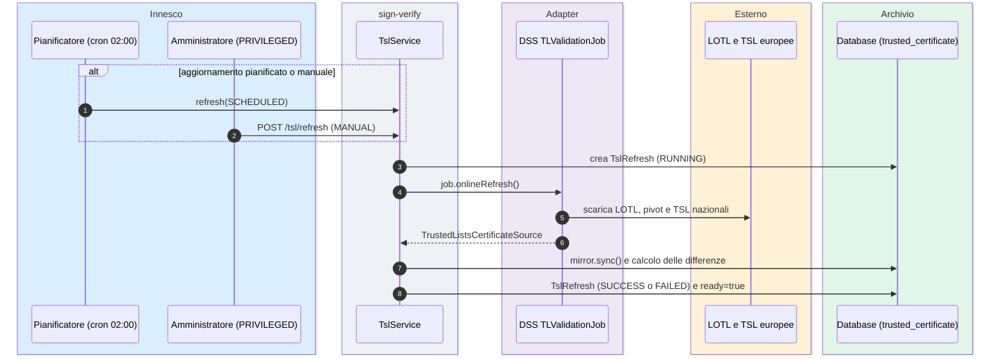

# 3. API dei certificati di fiducia (TSL)

← [2. Autenticazione](03-autenticazione.md) · [Indice](README.md) · → [4. Verifica delle firme](05-verifica-firme.md)

La fiducia nei certificati si basa sulle **liste di fiducia europee**: il
servizio carica la **LOTL** (la lista delle liste) e le TSL nazionali tramite la
libreria DSS, e ne copia i certificati di ancoraggio nel proprio database, così
da renderli interrogabili tramite API.

## 3.1 Come funziona l'aggiornamento



| Innesco | Dettaglio |
|---------|-----------|
| Pianificato | cron `0 0 2 * * *`, fuso orario `Europe/Rome` |
| All'avvio | `app.tsl.refresh.startup-mode` = `BACKGROUND` (carica all'avvio senza bloccare) oppure `SKIP` (per lo sviluppo o senza rete) |
| Manuale | `POST /api/v1/tsl/refresh`, solo `PRIVILEGED` |

Ogni aggiornamento registra un record `TslRefresh` con l'esito e il conteggio
delle differenze: certificati aggiunti, rimossi e invariati. I certificati non
più presenti nelle liste non vengono cancellati, ma **contrassegnati come
rimossi** (`removedAt`), e restano consultabili con `includeRemoved=true`.

## 3.2 Stato delle liste di fiducia

`GET /api/v1/tsl/status` è pubblico per gli utenti autenticati.

```bash
curl -sS http://localhost:8080/api/v1/tsl/status -H "X-API-Key: $KEY"
```

```json
{
  "lastRefresh": {
    "id": "…", "trigger": "SCHEDULED",
    "startedAt": "…", "completedAt": "…", "status": "SUCCESS",
    "certificatesAdded": 12, "certificatesRemoved": 3, "certificatesUnchanged": 240
  },
  "currentCertificateCount": 252,
  "ready": true
}
```

Il campo `ready` dice se le liste di fiducia sono state caricate con successo
almeno una volta ed è la stessa informazione che alimenta
`/actuator/health/readiness`.

## 3.3 Forzare un aggiornamento

`POST /api/v1/tsl/refresh` richiede il ruolo `PRIVILEGED`.

```bash
curl -sS -X POST http://localhost:8080/api/v1/tsl/refresh -H "X-API-Key: $ADMIN_KEY"
```

```json
{ "refreshId": "…", "status": "SUCCESS" }
```

## 3.4 Elenco dei certificati di fiducia

`GET /api/v1/tsl/certificates` accetta numerosi filtri e restituisce risultati
paginati (la busta è descritta in [Convenzioni](README.md#paginazione)).

| Parametro | Tipo | Descrizione |
|-----------|------|-------------|
| `ski` | string | Subject Key Identifier, corrispondenza esatta |
| `aki` | string | Authority Key Identifier, corrispondenza esatta |
| `subjectCn` / `subjectDn` | string | CN o DN del soggetto, corrispondenza parziale senza distinzione tra maiuscole e minuscole |
| `issuerCn` / `issuerDn` | string | CN o DN dell'emittente, corrispondenza parziale |
| `country` | string | Codice paese, corrispondenza esatta |
| `tspName` | string | Nome del prestatore di servizi fiduciari, corrispondenza parziale |
| `tspServiceType` | string | Tipo di servizio del prestatore, corrispondenza esatta |
| `tspServiceStatus` | string | Stato del servizio del prestatore, corrispondenza esatta |
| `serialNumber` | string | Numero di serie, corrispondenza esatta |
| `validAt` | date-time | Solo i certificati validi a quella data |
| `includeRemoved` | boolean | Include anche i certificati rimossi (predefinito `false`) |
| `page` / `size` | integer | Paginazione (predefiniti `0` e `50`) |

```bash
curl -sS "http://localhost:8080/api/v1/tsl/certificates?country=IT&tspName=Aruba&size=20" \
  -H "X-API-Key: $KEY"
```

Ogni elemento contiene, secondo la mappatura `certToMap`: `id`, `ski`, `aki`, `subjectDn`,
`subjectCn`, `issuerDn`, `issuerCn`, `serialNumber`, `country`, `tspName`,
`tspServiceType`, `tspServiceStatus`, `validFrom`, `validTo`, `lastSeenAt`,
`removedAt`, `certificateDerB64` (certificato DER in base64), `tslUrl`.

### Possibili valori per `tspServiceType`

| Valore | Significato |
|--------|-------------|
| `CA/QC` | Certification Authority che emette certificati qualificati |
| `QCertESeal` | Certificato qualificato per sigillo elettronico |
| `QCertESig` | Certificato qualificato per firma elettronica |
| `QTimestamp` | Marca temporale elettronica qualificata |
| `QWAC` | Certificato qualificato di autenticazione sito web |
| `QPreservation` | Servizio qualificato di conservazione di firme/sigilli elettronici qualificati |
| `QeIDASLogin` | Servizio di autenticazione eIDAS |
| `QeIDASNotify` | Servizio di notifica eIDAS |
| `QeIDASSignature` | Servizio di firma eIDAS |
| `QeIDASVerification` | Servizio di verifica eIDAS |

> I valori sono definiti da ETSI TS 119 612-1.

### Possibili valori per `tspServiceStatus`

| Valore | Significato |
|--------|-------------|
| `GRANTED` | Servizio attivamente autorizzato e in esercizio |
| `WITHDRAWN` | Servizio ritirato dal prestatore o dall'organismo di vigilanza |
| `SUPERSEDED` | Servizio sostituito da un altro servizio |
| `NOT_GRANTED` | Servizio non (o più) autorizzato |

## 3.5 Dettaglio di un certificato

`GET /api/v1/tsl/certificates/{id}` restituisce lo stesso oggetto del
dettaglio sopra per il certificato con quell'`id`.

```bash
curl -sS http://localhost:8080/api/v1/tsl/certificates/<uuid> -H "X-API-Key: $KEY"
```

## 3.6 Riepilogo permessi

| Endpoint | Ruolo richiesto |
|----------|-----------------|
| `GET /api/v1/tsl/status` | autenticato |
| `GET /api/v1/tsl/certificates` | autenticato |
| `GET /api/v1/tsl/certificates/{id}` | autenticato |
| `POST /api/v1/tsl/refresh` | **PRIVILEGED** |

## 3.7 Keystore OJ (ancora di fiducia della LOTL)

Per validare la **firma della LOTL**, DSS ha bisogno dei certificati di firma
**annunciati nella Gazzetta Ufficiale UE (Official Journal, OJ)**. Questi
certificati sono caricati da un keystore PKCS#12 configurato in
`application.yaml`:

```yaml
app:
  tsl:
    sources:
      - id: eu-lotl
        type: LOTL
        oj-keystore-path: classpath:keystore/oj-keystore.p12
        oj-keystore-password-env: APP_OJ_KEYSTORE_PASSWORD
        oj-url: https://eur-lex.europa.eu/legal-content/EN/TXT/?uri=uriserv:OJ.C_.2019.276.01.0001.01.ENG
```

> **Come si riconosce un keystore mancante o solo di prova**: se il keystore non
> contiene certificati OJ reali, ogni pivot fallisce con
> `INDETERMINATE/NO_CERTIFICATE_CHAIN_FOUND` e **nessuna TSL viene caricata**.
> All'avvio il servizio scrive un avviso esplicito nel log:
> `OJ keystore '...' contains no X.509 certificate ...`. In condizioni normali
> scrive invece `Loaded N OJ signing certificate(s) ...`.

### Rigenerare il keystore

1. Procurarsi i certificati di firma della LOTL come file `*.pem`/`*.crt`/`*.der`.
   La fonte autorevole è la pagina DSS
   <https://ec.europa.eu/digital-building-blocks/DSS/webapp-demo/oj-certificates>,
   che elenca i certificati OJ correnti con il loro **SHA256** e l'OJ di
   sincronizzazione (attualmente `OJ C/2026/1944`). I byte si estraggono dalla
   catena dei **pivot LOTL** (`eu-lotl.xml` + `eu-lotl-pivot-*.xml`, campo
   `<ds:X509Certificate>`) tenendo solo quelli la cui impronta SHA256 **combacia**
   con quelle pubblicate su quella pagina: è il controllo che protegge da
   manomissioni.
   > Il keystore versionato nel repository è già stato popolato così (6
   > certificati, OJ C/2026/1944); l'operazione va ripetuta quando la Gazzetta
   > Ufficiale pubblica un aggiornamento.
2. Metterli in una cartella (per impostazione predefinita `./oj-certs`) ed
   eseguire lo script:

   ```bash
   OJ_KEYSTORE_PASSWORD=changeit \
   scripts/update-oj-keystore.sh ./oj-certs src/main/resources/keystore/oj-keystore.p12
   ```

   Lo script importa tutti i certificati in `oj-keystore.p12` come
   `TrustedCertificateEntry` e stampa il contenuto finale. La password deve
   coincidere con l'`APP_OJ_KEYSTORE_PASSWORD` usata in esecuzione.
3. **Ricostruire l'immagine e riavviare** il servizio, poi forzare un
   aggiornamento (`POST /api/v1/tsl/refresh`) e verificare in
   `GET /api/v1/tsl/status` che `ready` sia `true`.

> Nota: i vecchi certificati **A-Trust**, con codifica RSA non standard, si
> riescono a caricare grazie al provider **BouncyCastle**, registrato
> automaticamente all'avvio.

### TSL nazionali che falliscono con `PKIX path building failed`

Alcuni endpoint TSL nazionali, per esempio `eidas.gov.ie`, in HTTPS presentano
**solo il certificato foglia**, senza quello intermedio: la JVM non riesce a
costruire la catena di fiducia e DSS non scarica quella lista. Il certificato
radice è già nell'archivio dei certificati fidati (per esempio *DigiCert Global
Root G2*), manca solo l'**intermedio**.

La soluzione è importare gli intermedi pubblici mancanti nell'archivio dei
certificati fidati della JRE. Quelli già noti sono versionati in
**`docker/tls-certs/`** e vengono importati in `cacerts` dal `Dockerfile` in
fase di costruzione dell'immagine. Per aggiungerne uno nuovo:

```bash
host=nuovo.host.tsl
# 1. trova l'URL "CA Issuers" (AIA) del certificato foglia
openssl s_client -connect $host:443 -servername $host </dev/null 2>/dev/null \
  | openssl x509 -noout -ext authorityInfoAccess
# 2. scarica l'intermedio e salvalo in formato PEM in docker/tls-certs/
curl -s http://.../intermediate.crt | openssl x509 -inform DER \
  -out docker/tls-certs/<nome>.pem
# 3. ricostruisci l'immagine
```

> L'opzione JVM `-Dcom.sun.security.enableAIAcaIssuers=true` **non** è
> affidabile in questo caso, perché non entra in gioco nel TrustManager TLS
> durante la negoziazione: meglio importare esplicitamente l'intermedio.
