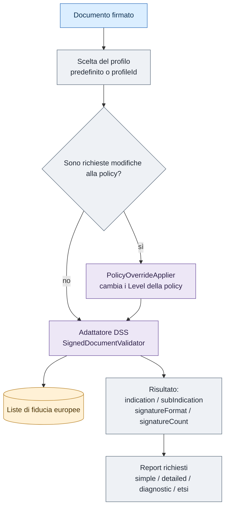
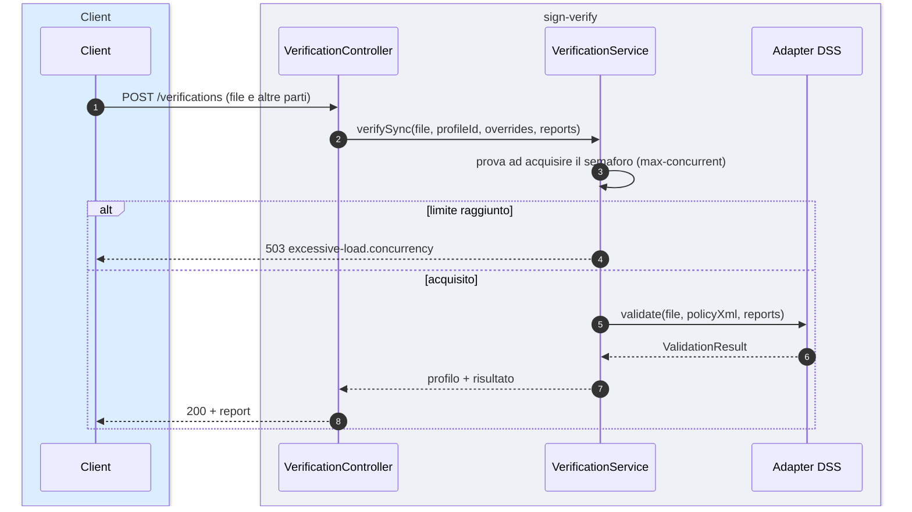
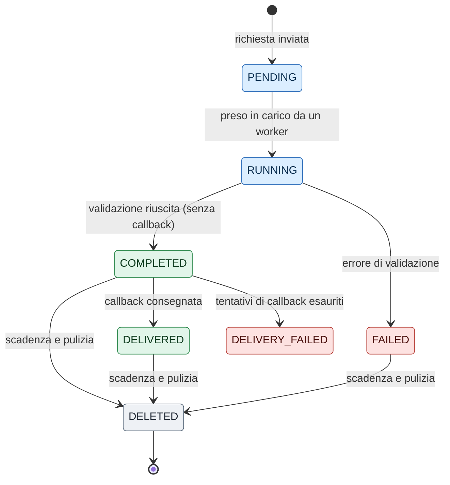
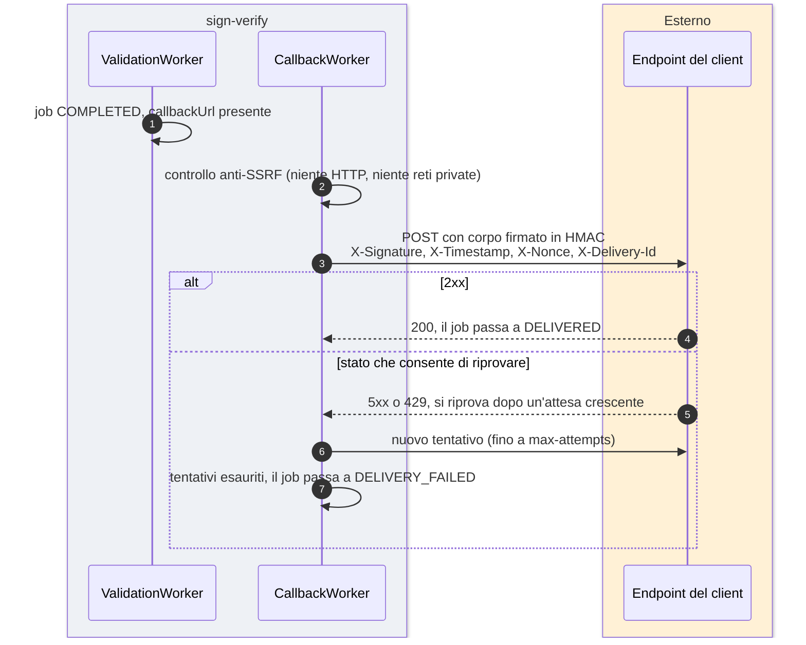

# 4. Verifica delle firme

← [3. API dei certificati di fiducia](04-trusted-certificates.md) · [Indice](README.md) · → [5. Estrazione dei file originali](06-estrazione-file.md)

- [4.1 Introduzione](#41-introduzione)
- [4.2 Profili di validazione](#42-profili-di-validazione)
  - [Formato della policy XML](#formato-della-policy-xml)
- [4.3 API di verifica sincrona](#43-api-di-verifica-sincrona)
- [4.4 API di verifica asincrona](#44-api-di-verifica-asincrona)

## 4.1 Introduzione

Il servizio verifica firme elettroniche eIDAS nei formati **PAdES** (PDF),
**CAdES** (`.p7m`), **XAdES** (XML), **JAdES** (JSON) e nei contenitori **ASiC**
(ASiC-S e ASiC-E), usando la libreria **DSS 6.4** e le **liste di fiducia
europee** come ancore di fiducia.

### Il percorso di una validazione



L'esito principale di DSS è espresso da:

- **`indication`** è l'esito complessivo: `TOTAL_PASSED`, `TOTAL_FAILED`,
  `INDETERMINATE`.
- **`subIndication`** è la motivazione di dettaglio quando l'esito non è
  `TOTAL_PASSED`, per esempio `SIG_CRYPTO_FAILURE`,
  `NO_CERTIFICATE_CHAIN_FOUND`, `OUT_OF_BOUNDS_NO_POE`.
- **`signatureFormat`** è il formato e il livello rilevati, per esempio
  `PAdES-BASELINE-B`.
- **`signatureCount`** è il numero di firme trovate.
- **`signatures[]`** riporta il dettaglio di ciascuna firma: `id`, `indication`,
  `subIndication`, `signatureFormat`, **`signatureLevel`** (la qualificazione
  eIDAS secondo DSS: `QESIG`, `QESEAL`, `ADESIG_QC` e altri, `NA`, più le
  varianti `INDETERMINATE_*`; è indipendente da `indication`), `signedBy`,
  `bestSignatureTime` e i `timestamps[]` della firma.
- **`timestamps[]`** elenca le marche temporali del documento: `id`,
  `indication`, `subIndication`, `productionTime` e `qualification` (`QTSA`,
  `TSA` o `NA`).

### Tipi di report

| Report | Descrizione |
|--------|-------------|
| `simple` | Riepilogo sintetico, con l'esito di ciascuna firma |
| `detailed` | Dettaglio dei singoli vincoli della policy |
| `diagnostic` | Dati grezzi raccolti da DSS durante la validazione |
| `etsi` | Report di validazione ETSI (TS 119 102-2) |

Le verifiche sincrone in parallelo sono limitate da un semaforo
(`app.verify.max-concurrent`, valore predefinito `8`); oltre quel limite la
richiesta riceve **503** (`excessive-load.concurrency`).

## 4.2 Profili di validazione

Un **profilo** incapsula una **policy di validazione DSS**, cioè il documento XML
dei vincoli. È il profilo a stabilire con quale severità vengono valutati i
singoli controlli: revoca, qualificazione, marche temporali e così via.

### Profili preconfigurati

| Nome | File della policy | Note |
|------|-------------------|------|
| `BASIC` | `policy/BASIC.xml` | Vincoli minimi; accetta sia firme AdES sia qualificate, senza distinguere il tipo (si veda SiVa POLv3) |
| `STANDARD` | `policy/STANDARD.xml` | Policy predefinita di DSS (QES e AES sulla base delle liste di fiducia), **creata come profilo predefinito** |
| `STRICT` | `policy/STRICT.xml` | Accetta solo firme qualificate, QES e QESeal (si veda SiVa POLv4) |
| `AGID` | `policy/AGID.xml` | Requisiti di base della firma digitale italiana: certificato qualificato (`QcCompliance`) e uso della chiave `nonRepudiation` obbligatori (CAD art. 24, DPCM 22/02/2013 art. 28) |
| `AGID_TS` | `policy/AGID_TS.xml` | Come `AGID`, con in più una marca temporale di livello T valida e obbligatoria |
| `CUSTOM` | - | Policy XML fornita da chi usa il servizio |

Al primo avvio, se non esiste alcun profilo, viene creato **STANDARD** come
profilo predefinito di sistema (`isDefault = true`). Vengono creati anche due
profili non predefiniti, pronti all'uso: **`AGID`** e **`AGID_TS`**. La
creazione iniziale si può ripetere senza effetti collaterali, perché salta ogni
nome già presente: un operatore può quindi personalizzare o eliminare quei
profili senza vederseli ricreare.

### Formato della policy XML

La policy è un documento XML nello **spazio dei nomi DSS**
`http://dss.esig.europa.eu/validation/policy`, con radice
`<ConstraintsParameters>`. È lo stesso formato usato dalla libreria DSS (si veda
*DSS: Validation policy*); i file `policy/BASIC.xml`, `policy/STANDARD.xml`,
`policy/STRICT.xml`, `policy/AGID.xml` e `policy/AGID_TS.xml` sono esempi
completi inclusi nel servizio.

#### Il concetto chiave: l'attributo `Level`

Quasi ogni vincolo porta un attributo `Level` che ne stabilisce la severità.
Determina **come** un controllo fallito influisce sull'esito (`indication` /
`subIndication`):

| `Level` | Significato | Effetto sull'esito |
|---------|-------------|--------------------|
| `FAIL` | Vincolo obbligatorio | Se non è soddisfatto l'esito diventa `TOTAL_FAILED` o `INDETERMINATE` |
| `WARN` | Avviso | Non blocca l'esito, viene solo segnalato nel report |
| `INFORM` | Informativo | Compare nel report come semplice informazione |
| `IGNORE` | Disattivato | Il controllo non viene eseguito |

Rendere un profilo più severo significa alzare il `Level` di alcuni vincoli, per
esempio da `WARN` a `FAIL`; renderlo più permissivo significa abbassarlo, per
esempio da `FAIL` a `IGNORE`. È esattamente quello che fanno gli
[override al volo](#override-al-volo), che portano a `IGNORE` alcuni vincoli
scelti.

#### Struttura del documento

I vincoli sono raggruppati in sezioni tematiche, valutate da DSS nelle varie
fasi della validazione:

| Sezione | Vincoli su |
|---------|-----------|
| `<ContainerConstraints>` | Contenitori ASiC-S / ASiC-E (tipi accettati, manifest, file firmati) |
| `<PDFAConstraints>` | Conformità PDF/A (per PAdES) |
| `<SignatureConstraints>` | La firma e la sua catena di certificati (blocco principale) |
| `<CounterSignatureConstraints>` | Eventuali contro-firme |
| `<Timestamp>` | Marche temporali (TSA) |
| `<Revocation>` | Dati di revoca (CRL / OCSP) |
| `<EvidenceRecord>` | Evidence record (RFC 4998 / 6283) |
| `<Cryptographic>` | Algoritmi e dimensioni di chiave ammessi, con le relative scadenze |
| `<Model Value="…"/>` | Modello di validazione: `SHELL`, `CHAIN` o `HYBRID` |
| `<eIDAS>` | Vincoli sulle liste di fiducia: aggiornamento, firma, versione |

Dentro `<SignatureConstraints>` i controlli sui certificati sono a loro volta
annidati in `<BasicSignatureConstraints>` → `<SigningCertificate>` (il
certificato del firmatario) e `<CACertificate>` (gli emittenti della catena),
più `<SignedAttributes>` per gli attributi firmati, per esempio `SigningTime`.

#### Forme dei vincoli

- **Vincolo semplice**: ha solo `Level`:
  ```xml
  <SignatureIntact Level="FAIL" />
  ```
- **Vincolo con elenco di valori**: accetta uno o più `<Id>` ammessi:
  ```xml
  <AcceptableContainerTypes Level="FAIL">
      <Id>ASiC-S</Id>
      <Id>ASiC-E</Id>
  </AcceptableContainerTypes>
  ```
- **Vincolo temporale**: usa `Unit` e `Value`:
  ```xml
  <RevocationFreshness Level="IGNORE" Unit="DAYS" Value="0" />
  <TLFreshness Level="WARN" Unit="HOURS" Value="6" />
  ```
- **Sezione `<Cryptographic>`**: elenca algoritmi di cifratura/digest ammessi,
  dimensioni minime di chiave e date di scadenza (`<AlgoExpirationDate>`), per
  rifiutare crittografia obsoleta (es. SHA-1, RSA-1024 oltre una certa data).

#### Esempio minimale commentato

```xml
<ConstraintsParameters Name="esempio minimale"
    xmlns="http://dss.esig.europa.eu/validation/policy">
  <!-- Solo container ASiC-E ammessi -->
  <ContainerConstraints>
    <AcceptableContainerTypes Level="FAIL">
      <Id>ASiC-E</Id>
    </AcceptableContainerTypes>
  </ContainerConstraints>
  <SignatureConstraints>
    <AcceptableFormats Level="FAIL">
      <Id>*</Id> <!-- qualunque formato di firma -->
    </AcceptableFormats>
    <BasicSignatureConstraints>
      <SignatureIntact Level="FAIL" />          <!-- la firma deve essere integra -->
      <ProspectiveCertificateChain Level="FAIL" /> <!-- catena verso una TL -->
      <SigningCertificate>
        <NotExpired Level="WARN" />             <!-- non bloccante se scaduto -->
        <NotRevoked Level="FAIL" />
        <RevocationDataAvailable Level="IGNORE" /> <!-- non richiedere revoca -->
      </SigningCertificate>
    </BasicSignatureConstraints>
  </SignatureConstraints>
  <Cryptographic Level="FAIL">
    <AcceptableDigestAlgo>
      <Algo>SHA256</Algo>
      <Algo>SHA512</Algo>
    </AcceptableDigestAlgo>
  </Cryptographic>
  <Model Value="SHELL" />
</ConstraintsParameters>
```

> Differenza fra i profili preconfigurati: `BASIC`, `STANDARD` e `STRICT` hanno
> la stessa struttura e si distinguono per i `Level` assegnati ai singoli
> vincoli, tanto che `STRICT` porta a `FAIL` controlli che `BASIC` lascia a
> `WARN` o `IGNORE`. `AGID` e `AGID_TS` vanno oltre e impongono quanto richiede
> la legge italiana, cioè un certificato qualificato con uso della chiave
> `nonRepudiation` e, per `AGID_TS`, una marca temporale di livello T valida:
> non è solo una questione di `Level` più severi. Per la grammatica completa
> fare riferimento alla documentazione ufficiale DSS (*Validation policy* e lo
> schema `policy.xsd`).

### Gestione dei profili (API)

| Metodo | Percorso | Operazione |
|--------|----------|-----------|
| `GET` | `/api/v1/profiles?page=&size=` | Elenco paginato (vedi [Convenzioni](README.md#paginazione)) |
| `POST` | `/api/v1/profiles` | Crea (`name`, `preset`, `policyXml?`) |
| `GET` | `/api/v1/profiles/{id}` | Dettaglio |
| `PUT` | `/api/v1/profiles/{id}` | Aggiorna (`description?`, `policyXml?`) |
| `DELETE` | `/api/v1/profiles/{id}` | Elimina |
| `POST` | `/api/v1/profiles/{id}/default` | Imposta come profilo predefinito |

Creazione di un profilo CUSTOM:

```bash
curl -sS -X POST http://localhost:8080/api/v1/profiles \
  -H "X-API-Key: $KEY" -H "Content-Type: application/json" \
  -d '{"name":"strict-pades","preset":"CUSTOM","policyXml":"<ConstraintsParameters …>…</…>"}'
```

> `policyXml` è obbligatorio quando `preset = CUSTOM`.

### Override al volo

Senza creare un profilo si possono **allentare** alcuni controlli per la singola
richiesta, passando valori booleani nella parte `profileOverrides` (oppure, sul
percorso deprecato, dentro il JSON `metadata`). Impostando una chiave a `false`,
i vincoli corrispondenti della policy vengono portati a `Level=IGNORE`:

| Chiave | Vincoli portati a `IGNORE` |
|--------|----------------------------|
| `checkRevocation` | `RevocationDataAvailable`, `RevocationDataFreshness`, `RevocationCertHashMatch` |
| `checkSignatureIntegrity` | `SignatureIntact`, `SignatureValid` |
| `checkCertificateChain` | `ProspectiveCertificateChain`, `TrustedServiceStatus` |
| `checkTimestamp` | `TimestampDelay`, `MessageImprintDataIntact` |
| `checkQualified` | `QualifiedCertificate` |

Gli override servono solo a disabilitare un controllo, quindi l'unico valore
utile è `false`. Quando ne viene applicato almeno uno, la risposta riporta
`overridesApplied: true`.

## 4.3 API di verifica sincrona

`POST /api/v1/verifications`: `multipart/form-data`.

Ogni opzione aggiuntiva viaggia in una parte dedicata di primo livello:

| Parte | Tipo | Obbligatoria | Descrizione |
|-------|------|--------------|-------------|
| `file` | binario | sì | Il documento firmato da verificare |
| `profile` | `string` | no | Nome del profilo di validazione da applicare, per esempio `AGID`. Alternativo a `profileId` |
| `profileId` | `string` (uuid) | no | **Deprecato**, si selezioni il profilo per nome con `profile`. UUID del profilo di validazione; se manca si usa il profilo predefinito. Alternativo a `profile` |
| `profileOverrides` | `string` (oggetto JSON) | no | Oggetto JSON di valori booleani per allentare controlli specifici (le chiavi sono elencate in §4.2) |
| `reports` | `string` (valori separati da virgola) | no | Tipi di report richiesti (`simple,detailed,diagnostic,etsi`); in mancanza, `simple,etsi` |
| `metadata` | application/json | no | **Deprecata.** Vecchia busta JSON con `profileId?`, `profileOverrides?`, `reports[]?`. Vedi la nota qui sotto |

> **`metadata` è deprecata e non si può usare insieme alle parti dedicate.**
> Va inviato *o* l'insieme delle singole parti *o* il vecchio JSON `metadata`:
> se arrivano entrambi, anche una sola parte dedicata insieme a `metadata`, la
> richiesta riceve **400**.

Se non è presente nessuna delle parti facoltative, vengono prodotti i report
`simple` ed `etsi` con il profilo predefinito.

```bash
curl -sS -X POST http://localhost:8080/api/v1/verifications \
  -H "X-API-Key: $KEY" \
  -F 'file=@contratto.pdf' \
  -F 'profile=AGID' \
  -F 'reports=simple,detailed' \
  -F 'profileOverrides={"checkRevocation":false}'
```

Risposta `200`:

```json
{
  "verifiedAt": "2026-06-08T10:15:30Z",
  "profileUsed": "STANDARD",
  "overridesApplied": true,
  "signatureFormat": "PAdES-BASELINE-B",
  "indication": "TOTAL_PASSED",
  "subIndication": null,
  "signatureCount": 1,
  "signatures": [
    {
      "id": "S-1",
      "indication": "TOTAL_PASSED",
      "subIndication": null,
      "signatureFormat": "PAdES_BASELINE_B",
      "signatureLevel": "QESIG",
      "signedBy": "CN=Mario Rossi, …",
      "bestSignatureTime": "2026-06-08T10:14:00Z",
      "timestamps": []
    }
  ],
  "timestamps": [],
  "reports": {
    "simple":   { /* … */ },
    "detailed": { /* … */ }
  }
}
```

I valori ammessi per `reports` sono `simple`, `detailed`, `diagnostic` ed
`etsi`, separati da virgola. Un valore sconosciuto produce **400**
(`unknown report type`). Un `profileOverrides` con JSON malformato produce
**400** (`invalid profileOverrides json`), e lo stesso vale per il vecchio
`metadata` (`invalid metadata json`). Anche mescolare le parti dedicate con la
vecchia parte `metadata` produce **400**.

### Timestamp del documento vs timestamp di archivio

La risposta contiene due elenchi di marche temporali a livello di firma:

- **`timestamps[]`** raccoglie le marche della firma, livelli T e LT: sono le
  marche incorporate nella firma o che la coprono, e provano che la firma
  esisteva già prima del momento in cui la marca è stata prodotta.
- **`archiveTimestamps[]`** raccoglie le marche di archivio, livello LTA.
  Provengono dagli **evidence record** (RFC 4998 e 6283) e danno prova di
  conservazione a lungo termine. Vengono valorizzate solo quando la libreria DSS
  trova evidence record nella firma.

> **Nota:** `archiveTimestamps` può risultare vuoto anche su firme LTA se le
> liste di fiducia non sono attive, perché per elaborare fino in fondo gli
> evidence record DSS deve potervi accedere.

### Campi della risposta

| Campo | Tipo JSON | Obbligatorio | Descrizione | Valori possibili |
|-------|-----------|--------------|-------------|------------------|
| `verifiedAt` | `string` | sì | Istante della verifica (ISO-8601 UTC) | es. `2026-06-08T10:15:30Z` |
| `profileUsed` | `string` | sì | Nome del profilo di validazione applicato | `STANDARD`, `AGID`, `AGID_TS`, oppure un nome personalizzato |
| `overridesApplied` | `boolean` | sì | Indica se sono stati applicati override al volo alla policy | `true`, `false` |
| `signatureFormat` | `string` | sì | Formato e livello della firma rilevati | es. `PAdES-BASELINE-B`, `CAdES-BASELINE-B` |
| `indication` | `string` | sì | Esito complessivo della validazione | `TOTAL_PASSED`, `TOTAL_FAILED`, `INDETERMINATE` |
| `subIndication` | `string` o `null` | sì | Motivazione di dettaglio quando non è `TOTAL_PASSED` | `null`, oppure codici definiti da DSS come `SIG_CRYPTO_FAILURE`, `NO_CERTIFICATE_CHAIN_FOUND`, `OUT_OF_BOUNDS_NO_POE` |
| `signatureCount` | `integer` | sì | Numero di firme trovate nel documento | `0`, `1`, `2`… |
| `signatures` | `array` | sì | Dettagli per firma | Array di oggetti `Signature` |
| `signatures[].id` | `string` | sì | Identificativo della firma | es. `S-1` |
| `signatures[].indication` | `string` | sì | Esito a livello di firma | `TOTAL_PASSED`, `TOTAL_FAILED`, `INDETERMINATE` |
| `signatures[].subIndication` | `string` o `null` | sì | Motivazione di dettaglio a livello di firma | `null`, oppure codici definiti da DSS |
| `signatures[].signatureFormat` | `string` | sì | Formato di firma rilevato per questa firma | es. `PAdES_BASELINE_B` |
| `signatures[].signatureLevel` | `string` | sì | Qualifica eIDAS della firma | `QESIG`, `QESEAL`, `ADESIG_QC`, `NA`, `INDETERMINATE_*` |
| `signatures[].signedBy` | `string` | sì | Distinguished Name del firmatario | es. `CN=Mario Rossi, …` |
| `signatures[].bestSignatureTime` | `string` o `null` | sì | Miglior tempo di firma provato (ISO-8601 UTC) | es. `2026-06-08T10:14:00Z`, oppure `null` |
| `signatures[].claimedSigningTime` | `string` o `null` | no | Tempo di firma dichiarato negli attributi firmati (ISO-8601 UTC) | es. `2026-06-08T10:13:00Z`, oppure `null` |
| `signatures[].timestamps` | `array` | sì | Marche temporali della firma (livello T/LT) | Array di oggetti `Timestamp` |
| `signatures[].timestamps[].id` | `string` | sì | Identificativo della marca temporale | es. `T-1` |
| `signatures[].timestamps[].indication` | `string` | sì | Esito della validazione della marca temporale | `PASSED`, `FAILED`, `INDETERMINATE` |
| `signatures[].timestamps[].subIndication` | `string` o `null` | sì | Motivazione di dettaglio della marca temporale | `null`, oppure codici definiti da DSS |
| `signatures[].timestamps[].productionTime` | `string` o `null` | sì | Tempo di produzione della marca temporale (ISO-8601 UTC) | es. `2026-06-08T10:14:00Z`, oppure `null` |
| `signatures[].timestamps[].qualification` | `string` | sì | Qualifica della TSA | `QTSA`, `TSA`, `NA` |
| `signatures[].archiveTimestamps` | `array` | sì | Marche temporali di archivio (livello LTA/evidence record) | Array di oggetti `ArchiveTimestamp`; vuoto se assenti |
| `signatures[].archiveTimestamps[].id` | `string` | sì | Identificativo della marca di archivio | es. `A-1` |
| `signatures[].archiveTimestamps[].productionTime` | `string` o `null` | sì | Tempo di produzione della marca di archivio (ISO-8601 UTC) | es. `2026-06-08T10:14:00Z`, oppure `null` |
| `signatures[].certificates` | `array` | sì | Certificati coinvolti nella firma | Array di oggetti `Certificate` |
| `signatures[].certificates[].id` | `string` | sì | Identificativo del certificato | es. `C-1` |
| `signatures[].certificates[].qualifiedName` | `string` | sì | Nome qualificato del soggetto del certificato | es. `CN=Mario Rossi, …` |
| `signatures[].certificates[].sunsetDate` | `string` o `null` | sì | Data oltre la quale il certificato non è più considerato affidabile, se prevista (ISO-8601 UTC) | es. `2027-12-31T23:59:59Z`, oppure `null` |
| `timestamps` | `array` | sì | Marche temporali a livello documento | Array di oggetti `Timestamp` (stesso schema di `signatures[].timestamps[]`) |
| `reports` | `object` | sì | Report di validazione richiesti | Oggetto con chiavi `simple`, `detailed`, `diagnostic`, `etsi` |
| `reports.simple` | `object` o `null` | sì* | Riepilogo sintetico, con l'esito di ciascuna firma | `null` se non richiesto |
| `reports.detailed` | `object` o `null` | sì* | Dettaglio dei singoli vincoli della policy | `null` se non richiesto |
| `reports.diagnostic` | `object` o `null` | sì* | Dati grezzi raccolti da DSS durante la validazione | `null` se non richiesto |
| `reports.etsi` | `object` o `null` | sì* | Report di validazione ETSI (TS 119 102-2) | `null` se non richiesto |

> \* I sotto-campi di `reports` sono sempre presenti ma possono essere `null` quando il corrispondente tipo di report non è stato richiesto.

### Valori degli enum

**`indication`**

| Valore | Significato |
|--------|-------------|
| `TOTAL_PASSED` | La firma è valida e tutti i vincoli sono stati superati |
| `TOTAL_FAILED` | La firma non è valida: almeno un vincolo FAIL non è stato superato |
| `INDETERMINATE` | L'esito non può essere determinato (es. TSL mancante, informazioni insufficienti) |

**`signatureLevel`** è la qualifica eIDAS DSS (ETSI TS 119 102-1) ed è ortogonale a `indication`.

| Valore | Significato |
|--------|-------------|
| `QESIG` | Firma Elettronica Qualificata |
| `QESEAL` | Sigillo Elettronico Qualificato |
| `ADESIG_QC` | Firma Elettronica Avanzata con certificato qualificato |
| `ADESEAL_QC` | Sigillo Elettronico Avanzato con certificato qualificato |
| `NA` | Non valutato / non applicabile |
| `INDETERMINATE_QESIG` | Firma elettronica qualificata indeterminata |
| `INDETERMINATE_QESEAL` | Sigillo elettronico qualificato indeterminato |
| `INDETERMINATE_ADESIG_QC` | AdESig con certificato qualificato indeterminata |
| `INDETERMINATE_ADESEAL_QC` | AdESeal con certificato qualificato indeterminata |

### Risposte di errore

Il [catalogo completo degli errori](07-log-audit.md#62-gestione-degli-errori-problemjson)
elenca tutti i codici. Su questo endpoint i più probabili sono i seguenti.

**400: `metadata` malformato**

```json
{"type":"urn:signverify:error:validation.invalid-input","title":"Bad Request","status":400,"detail":"invalid metadata json","instance":"/api/v1/verifications"}
```

**400: due modi di comporre la richiesta usati insieme** (parti dedicate e vecchio `metadata`)

```json
{"type":"urn:signverify:error:validation.invalid-input","title":"Bad Request","status":400,"detail":"provide either the 'metadata' part or the individual parts, not both","instance":"/api/v1/verifications"}
```

**413: file troppo grande**

```json
{"type":"urn:signverify:error:payload.too-large","title":"Payload Too Large","status":413,"detail":"max upload size exceeded","instance":"/api/v1/verifications"}
```

**503: limite di concorrenza raggiunto**

```json
{"type":"urn:signverify:error:excessive-load.concurrency","title":"Service Unavailable","status":503,"detail":"verify concurrency limit reached","instance":"/api/v1/verifications"}
```

**200 con `INDETERMINATE`**

```json
{
  "verifiedAt": "2026-06-08T10:15:30Z",
  "profileUsed": "STANDARD",
  "overridesApplied": false,
  "signatureFormat": "PAdES-BASELINE-B",
  "indication": "INDETERMINATE",
  "subIndication": "NO_CERTIFICATE_CHAIN_FOUND",
  "signatureCount": 1,
  "signatures": [
    {
      "id": "S-1",
      "indication": "INDETERMINATE",
      "subIndication": "NO_CERTIFICATE_CHAIN_FOUND",
      "signatureFormat": "PAdES_BASELINE_B",
      "signatureLevel": "INDETERMINATE_QESIG",
      "signedBy": "CN=Mario Rossi, …",
      "bestSignatureTime": "2026-06-08T10:14:00Z",
      "claimedSigningTime": null,
      "timestamps": [],
      "archiveTimestamps": [],
      "certificates": []
    }
  ],
  "timestamps": [],
  "reports": { "simple": { }, "etsi": { } }
}
```



## 4.4 API di verifica asincrona

Per i documenti grandi o per la consegna del risultato tramite **callback HTTP**
si usa il flusso asincrono, basato su job salvati su database.

### Invio della richiesta

`POST /api/v1/verifications/async`: `multipart/form-data`.

Oltre al `file` obbligatorio accetta le stesse parti dedicate dell'endpoint
sincrono: `profile` (il nome), il deprecato `profileId` (l'UUID),
`profileOverrides` (JSON), `reports` (valori separati da virgola, in mancanza
`simple,etsi`), più le parti per la callback `callbackUrl?`, `callbackSecret?`
e `callbackAlgorithm?`. La vecchia busta JSON `metadata`, che porta anche le tre
chiavi `callback*`, è ancora accettata come **alternativa**: mescolarla con una
qualsiasi parte dedicata produce **400**.

```bash
curl -sS -X POST http://localhost:8080/api/v1/verifications/async \
  -H "X-API-Key: $KEY" \
  -F 'file=@grande.pdf' \
  -F 'reports=simple,etsi' \
  -F 'callbackUrl=https://app.example.org/hook' \
  -F 'callbackSecret=s3cr3t' \
  -F 'callbackAlgorithm=HmacSHA256'
```

Risposta `202`:

```json
{ "jobId": "…", "status": "PENDING" }
```

con header `Location: /api/v1/verifications/jobs/<jobId>`.

**Limite sulla coda**: se i job attivi superano il limite del singolo chiamante
(`max-pending-per-principal`, 50 in mancanza di altre impostazioni) o quello
complessivo (`max-pending-global`, 500), la richiesta riceve **429**
(`excessive-load.async-backpressure`).

### Ciclo di vita del job



Stati (`JobStatus`): `PENDING`, `RUNNING`, `COMPLETED`, `FAILED`, `DELIVERED`,
`DELIVERY_FAILED`, `DELETED`.

### Valori di JobStatus

| Valore | Significato |
|--------|-------------|
| `PENDING` | Job ricevuto, in attesa di essere preso in carico |
| `RUNNING` | Job in elaborazione |
| `COMPLETED` | Validazione conclusa correttamente |
| `FAILED` | Validazione terminata con un errore |
| `DELIVERED` | Risultato consegnato alla callback |
| `DELIVERY_FAILED` | Tentativi di consegna esauriti senza successo |
| `DELETED` | Job scaduto e rimosso alla fine del periodo di conservazione |

Il **ValidationWorker** interroga periodicamente la coda
(`async.worker.poll-interval`, `5s` in mancanza di altre impostazioni), prende in
carico i job in attesa e li elabora; se l'interruttore di protezione
`dssValidator` è **aperto**, salta il ciclo. Il segreto della callback è cifrato
a riposo (AES-256-GCM) con la chiave master.

### Recupero del risultato

`GET /api/v1/verifications/jobs/{jobId}`.

- È visibile al **proprietario** del job o a un chiamante **PRIVILEGED**; a
  chiunque altro risponde **404**, per non rivelare che il job esiste.
- Se lo stato è `DELETED` il risultato non è più disponibile: **410 Gone**.

```json
{
  "jobId": "…",
  "status": "DELIVERED",
  "createdAt": "…", "startedAt": "…", "completedAt": "…", "deliveredAt": "…",
  "expiresAt": "…",
  "callbackAttempts": 1,
  "result": { /* report JSON */ }
}
```

### Consegna del risultato tramite callback HTTP



Chi consegna la callback firma il corpo in HMAC (`HmacSHA256` in mancanza di
altre indicazioni, oppure `HmacSHA512`) e aggiunge gli header di firma e di
protezione dai rinvii:

| Header | Significato |
|--------|-------------|
| `X-Signature` | HMAC del corpo, insieme a timestamp, nonce e identificativo di consegna |
| `X-Signature-Algorithm` | algoritmo usato |
| `X-Timestamp`, `X-Nonce` | proteggono dal rinvio della stessa richiesta |
| `X-Job-Id`, `X-Delivery-Id`, `X-Delivery-Attempt` | correlazione |

**Corpo**: `Content-Type: application/json`. Su `COMPLETED`, `result` è lo
stesso oggetto restituito da `GET /api/v1/verifications/jobs/{jobId}`:

```json
{
  "jobId": "5e9b1f2a-...",
  "status": "COMPLETED",
  "result": { "indication": "TOTAL_PASSED", "...": "..." }
}
```

Su `FAILED`, `result` è assente e `error` riporta il messaggio di errore:

```json
{
  "jobId": "5e9b1f2a-...",
  "status": "FAILED",
  "error": "signature.parse-error: unrecognised document format"
}
```

> **Verificare `X-Signature`**: non è un semplice HMAC del corpo. Calcola
> `sha256(corpo)` come stringa hex, costruisci la stringa canonica
> `<X-Timestamp>\n<X-Nonce>\n<X-Delivery-Id>\n<bodyHashHex>`, poi calcola
> l'HMAC di questa stringa con `callbackSecret` usando l'algoritmo indicato in
> `X-Signature-Algorithm`. Il valore dell'header è `sha256=<hex>` oppure
> `sha512=<hex>`. Ricalcolalo e confrontalo prima di fidarti del corpo, e
> rifiuta le richieste con un `X-Timestamp` non recente: è così che si evita di
> accettare due volte la stessa consegna.

**Protezione anti-SSRF**: sono ammessi solo URL **HTTPS**
(`allow-http=false`) e vengono bloccati gli host che risolvono a indirizzi
**privati o non instradabili**: loopback, link-local compreso
`169.254.169.254`, site-local, ULA IPv6 e multicast. Un host che non si risolve
viene trattato come privato, quindi bloccato. Per i nuovi tentativi valgono
`max-attempts` (3 in mancanza di altre impostazioni), le attese
`60s,300s,1800s`, gli stati di successo `200,201,202,204` e gli stati dopo i
quali si riprova `408,425,429,500,502,503,504`.
