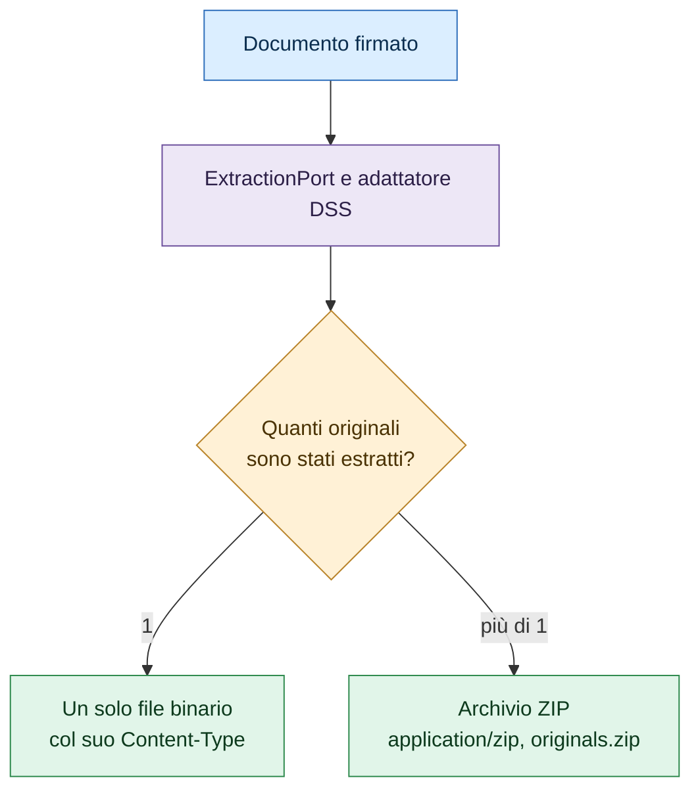

# 5. Estrazione dei file originali

← [4. Verifica firme](05-verifica-firme.md) · [Indice](README.md) · → [6. Log e audit](07-log-audit.md)

Oltre a verificare la firma, il servizio può **estrarre il contenuto originale**
incapsulato in un documento firmato, per esempio il PDF dentro un `.p7m`
(CAdES) o i file all'interno di un contenitore **ASiC**.

## 5.1 Endpoint

`POST /api/v1/extractions`: `multipart/form-data`, parte `file` obbligatoria.



## 5.2 Comportamento della risposta

L'adattatore DSS individua i documenti originali e ne deduce il formato di firma:

- **Un solo originale**: il file viene restituito **direttamente** come binario,
  con il `Content-Type` corrispondente al suo tipo MIME e
  `Content-Disposition: attachment; filename="<nome>"`.
- **Più originali**, caso tipico degli ASiC-E: vengono raccolti in un archivio
  **ZIP** (`application/zip`) chiamato `originals.zip`.

In entrambi i casi la risposta porta due header informativi:

| Header | Significato |
|--------|-------------|
| `X-Signature-Format` | Formato di firma rilevato, per esempio `CAdES` o `ASiC-E` |
| `X-Document-Count` | Numero di documenti originali estratti |

## 5.3 Esempi

Estrazione di un singolo file, per esempio un PDF dentro un `.p7m`:

```bash
curl -sS -X POST http://localhost:8080/api/v1/extractions \
  -H "X-API-Key: $KEY" \
  -F 'file=@contratto.pdf.p7m' \
  -D - -o contratto.pdf
# Header di risposta:
#   X-Signature-Format: CAdES
#   X-Document-Count: 1
#   Content-Disposition: attachment; filename="contratto.pdf"
```

Estrazione di un contenitore con più file (ASiC-E):

```bash
curl -sS -X POST http://localhost:8080/api/v1/extractions \
  -H "X-API-Key: $KEY" \
  -F 'file=@pacchetto.asice' \
  -o originals.zip
# X-Document-Count: 3  →  originals.zip
```

## 5.4 Note

- L'endpoint richiede solo un chiamante autenticato, con qualsiasi ruolo.
- Un documento non firmato o non riconosciuto produce l'errore
  `signature.parse-error` (vedi la gestione degli errori in
  [6. Log e audit](07-log-audit.md)).
- L'estrazione non lascia traccia: non crea job e non salva nulla su disco.

## 5.5 Estrazione da TSD

Il servizio estrae anche dai file **RFC 5544 TimeStampedData** (`.tsd`),
prodotti di frequente dagli strumenti della PA italiana come ArubaSign, GoSign
e Namirial.

DSS 6.4 non riconosce il formato TSD, perciò l'adattatore di estrazione apre
l'involucro TSD con **Bouncy Castle** (`CMSTimeStampedData`) e restituisce
direttamente il contenuto interno. La risposta riporta
`X-Signature-Format: RFC5544_TSD`.

```bash
curl -sS -X POST http://localhost:8080/api/v1/extractions \
  -H "X-API-Key: $KEY" \
  -F 'file=@documento.tsd' \
  -D - -o documento.pdf
# X-Signature-Format: RFC5544_TSD
# X-Document-Count: 1
```

> **Nota:** se il contenuto interno è a sua volta un `.p7m` CAdES firmato,
> vengono restituiti i byte grezzi del `.p7m`, non i file che contiene. Per
> arrivare fino in fondo occorre estrarre in due passaggi: prima il `.tsd`, poi
> il `.p7m` che ne esce.
