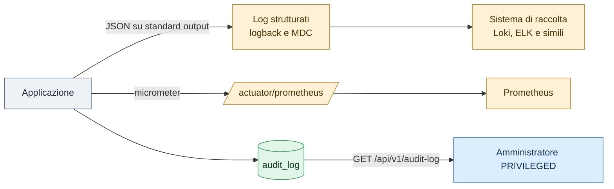
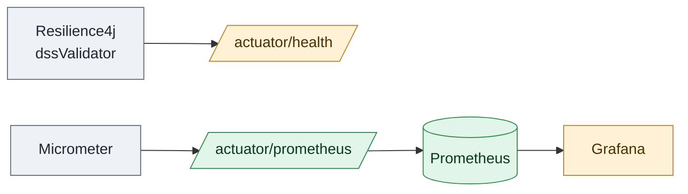

# 6. Log e audit

← [5. Estrazione file](06-estrazione-file.md) · [Indice](README.md) · → [7. Scalabilità orizzontale](08-scalabilita-orizzontale.md)

Per capire cosa sta facendo il servizio ci sono tre strumenti: i **log
applicativi strutturati**, le **metriche** esposte da Actuator per Prometheus e
un **registro di audit** persistente, interrogabile tramite API.



## 6.1 Log applicativi

I log escono in **JSON** sullo standard output tramite Logback
(`logback-spring.xml`, con il codificatore `LoggingEventCompositeJsonEncoder` di
logstash). Ogni evento riporta l'istante, il livello, il thread, il logger, il
messaggio, l'eventuale traccia dell'eccezione, il campo `app` con il nome
dell'applicazione e il contenuto dell'**MDC**.

Livelli predefiniti (`application.yaml`):

| Logger | Livello |
|--------|---------|
| root | `INFO` |
| `org.toresoft.signverify` | `INFO` |
| `eu.europa.esig` (DSS) | `WARN` |

### Contesto per richiesta (MDC)

`RequestContextFilter` popola l'MDC a ogni richiesta, così ogni riga di log è
correlabile:

| Chiave MDC | Contenuto |
|------------|-----------|
| `requestId` | UUID generato per la richiesta |
| `clientIp` | indirizzo IP del chiamante |
| `principalType` | `API_KEY`, `OAUTH_USER` o `SYSTEM`, se la richiesta è autenticata |
| `principalId` | identificativo del principal, se la richiesta è autenticata |

Al termine della richiesta l'MDC viene **azzerato** (`MDC.clear()`).

### Rotazione

L'applicazione scrive sullo standard output, quindi la **rotazione** spetta a
chi esegue il container. In `docker-compose.prod.yml` il driver `json-file`
ruota a `max-size: 10m` conservando `max-file: 3` file.

## 6.2 Gestione degli errori (problem+json)

Gli errori applicativi derivano da `AppException` e il `GlobalExceptionHandler`
li restituisce come `application/problem+json` secondo la **RFC 9457**. Il campo
`type` ha la forma `urn:signverify:error:<codice>`.

| Codice errore | HTTP | Quando |
|---------------|------|--------|
| `validation.invalid-input` | 400 | dati in ingresso non validi: vincoli di validazione, JSON malformato, parametro errato |
| `auth.invalid-token` | 401 | API key assente, malformata, sconosciuta, disabilitata o scaduta, oppure JWT non valido |
| `authz.forbidden` | 403 | ruolo insufficiente, per esempio `STANDARD` su un endpoint riservato ai `PRIVILEGED` |
| `resource.not-found` | 404 | risorsa inesistente o non visibile al chiamante |
| `resource.conflict` | 409 | conflitto, per esempio la rimozione dell'ultima chiave privilegiata |
| `payload.too-large` | 413 | caricamento oltre i limiti |
| `signature.parse-error` | 422 | documento non firmato o illeggibile |
| `excessive-load.async-backpressure` | 429 | coda dei job asincroni piena |
| `excessive-load.concurrency` | 503 | semaforo delle verifiche sincrone esaurito |
| `tsl.not-ready` | 503 | liste di fiducia non ancora caricate |
| `dss.unavailable` | 503 | interruttore di protezione di DSS aperto |
| `internal-error` | 500 | errore non previsto |

> **Riservati, non ancora emessi**: `validation.invalid-profile-overrides`,
> `auth.missing-credentials` e `media.unsupported` sono codici dichiarati ma
> senza un punto del codice che li sollevi oggi. Un header
> `X-API-Key`/`Authorization` assente emerge oggi comunque come
> `auth.invalid-token`; un valore di `profileOverrides` non valido finisce nel
> generico `internal-error` (500) invece che in un 400. È una lacuna nota, non
> ancora corretta.

Tutte le risposte condividono la stessa busta e cambiano solo `type`, `status`,
`title` e `detail`. C'è sempre anche un campo `code` stabile e pensato per essere
letto da un programma, con lo stesso valore contenuto nell'URN di `type`, così i
client non devono interpretare l'URN:

```json
{
  "type": "urn:signverify:error:resource.conflict",
  "code": "resource.conflict",
  "title": "Conflict",
  "status": 409,
  "detail": "cannot remove last enabled privileged api key",
  "instance": "/api/v1/api-keys/3f1e..."
}
```

### Validazione a livello di campo (`invalid-params`)

Le risposte `validation.invalid-input` (400) contengono anche l'elenco
`invalid-params`, il membro di estensione previsto dalla RFC 9457 §3.1, con
**una voce per ogni dato respinto**: il client può così collegare l'errore a un
campo preciso invece di interpretare `detail`. Viene valorizzato per i vincoli di
validazione sul corpo della richiesta, per i campi del corpo malformati o di tipo
sbagliato (valore non ammesso in un'enumerazione, tipo errato) e per i parametri
di percorso o di query che non superano la conversione o la validazione: `page`
non numerico, `{id}` con UUID malformato, parametro obbligatorio mancante.

```json
{
  "type": "urn:signverify:error:validation.invalid-input",
  "code": "validation.invalid-input",
  "title": "Bad Request",
  "status": 400,
  "detail": "name: must not be null; role: must not be null",
  "instance": "/api/v1/api-keys",
  "invalid-params": [
    { "name": "name", "reason": "must not be null" },
    { "name": "role", "reason": "must not be null" }
  ]
}
```

Ogni voce ha un `name`, cioè il campo o il parametro (`name`, `page`,
`items[2].role`), e un `reason` leggibile. Un errore di pura sintassi JSON non è
riconducibile a un campo: in quel caso `invalid-params` viene omesso e `detail`
vale `"malformed request body"`.

| Codice errore | Esempio `detail` |
|---------------|-------------------|
| `validation.invalid-input` | `"size must be between 1 and 100"` |
| `auth.invalid-token` | `"invalid credentials"` |
| `authz.forbidden` | `"insufficient role"` |
| `resource.not-found` | `"api key not found"` |
| `resource.conflict` | `"cannot remove last enabled privileged api key"` |
| `payload.too-large` | `"max upload size exceeded"` |
| `signature.parse-error` | `"cannot parse signed document: ..."` |
| `excessive-load.async-backpressure` | `"global async backpressure"` oppure `"per-principal async backpressure"` |
| `excessive-load.concurrency` | `"verify concurrency limit reached"` |
| `tsl.not-ready` | `"tsl not ready"` |
| `dss.unavailable` | `"dss circuit breaker open: ..."` |
| `internal-error` | `"unexpected error"` |

> `server.error.include-message` e `include-stacktrace` valgono entrambi
> `never`: i dettagli interni non trapelano nelle risposte.

## 6.3 Registro di audit

Esistono una tabella **`audit_log`** e un'API di consultazione riservata agli
amministratori. Struttura del record (`AuditLog`):

| Campo | Descrizione |
|-------|-------------|
| `id` | UUID |
| `occurredAt` | istante dell'evento |
| `principalType` / `principalId` | chi ha eseguito l'azione, oppure `SYSTEM` |
| `action` | azione svolta |
| `targetType` / `targetId` | risorsa interessata |
| `success` | esito, vero o falso |
| `details` | JSON libero |
| `ipAddress` | indirizzo IP del chiamante |

### Consultazione

`GET /api/v1/audit-log`: **richiede ruolo `PRIVILEGED`**. Restituisce la busta
di paginazione condivisa (vedi [Convenzioni](README.md#paginazione)). Filtri
disponibili:

| Parametro | Tipo |
|-----------|------|
| `principalId` | string |
| `action` | string |
| `from` / `to` | date-time |
| `targetType` / `targetId` | string |
| `success` | boolean |
| `page` / `size` | integer (predefiniti `0` e `50`) |

I risultati sono ordinati per `occurredAt` decrescente.

```bash
curl -sS "http://localhost:8080/api/v1/audit-log?action=verify&success=false&size=20" \
  -H "X-API-Key: $ADMIN_KEY"
```

```json
{
  "page": 0, "size": 20, "totalElements": 0, "totalPages": 0,
  "content": [ /* AuditLog[] */ ]
}
```

> **Stato attuale dell'implementazione.** La tabella `audit_log`, il
> componente `AuditService` (scrittura) e l'API di lettura sono presenti e
> indicizzati (`occurred_at`, `principal_id`, `action`). Nel codice attuale
> `AuditService` **non è ancora collegato** ai percorsi operativi (verifica,
> gestione delle chiavi, aggiornamento delle liste di fiducia), quindi la tabella
> può risultare vuota: la tracciabilità operativa è oggi affidata ai **log
> strutturati** con MDC (§6.1). L'infrastruttura di audit persistente esiste già
> e si può collegare a quelle operazioni quando serve.

## 6.4 Metriche

Endpoint Actuator esposti: `health`, `info`, `metrics`, `prometheus`.

- `GET /actuator/prometheus`: metriche Micrometer in formato Prometheus,
  raggiungibile senza autenticazione.
- L'interruttore di protezione `dssValidator` (Resilience4j) pubblica un
  indicatore di salute ed espone metriche sul proprio stato (`CLOSED`, `OPEN`,
  `HALF_OPEN`), utili per tenere d'occhio la disponibilità della validazione DSS.


