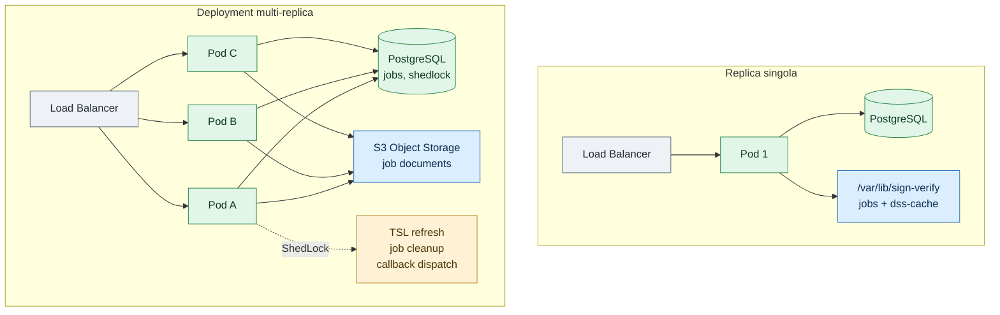

# 7. Scalabilità orizzontale

← [6. Log e audit](07-log-audit.md) · [Indice](README.md)

Il servizio può essere replicato orizzontalmente quando il carico di verifiche
asincrone o sincrone supera la capacità di un singolo pod. Questa pagina
descrive i meccanismi che rendono la replica sicura e le condizioni in cui
vale la pena scalare.

## 7.1 Quando una replica sola basta, e quando no

Una singola istanza gestisce bene carichi moderati:

- Le verifiche **sincrone** sono vincolate da un semaforo
  (`verify.max-concurrent`, default 8). Il throughput è CPU-bound sulla
  libreria DSS: ogni verifica carica catene di certificati, CRL/OCSP e TSL.
- I job **asincroni** forniscono backpressure tramite i limiti
  `async.max-pending-per-principal` e `async.max-pending-global`. Il client
  riceve 429 se la coda è piena, quindi il sistema non collassa sotto picchi.

Scalare orizzontalmente ha senso quando:

- il semaforo sincrono è saturo per la maggior parte del tempo e il client
  non può tollerare attese;
- la coda asincrona cresce costantemente nonostante la backpressure;
- si vuole tolleranza ai guasti: se un pod cade, gli altri continuano a
  servire verifiche sincrone e a processare job.

## 7.2 Cosa rende il servizio scalabile orizzontalmente

### Pod stateless

I pod sono stateless. Gli unici path scrivibili sotto `/var/lib/sign-verify`
sono:

| Path | Contenuto | Condivisibile? |
|------|-----------|----------------|
| `jobs/` | Documenti dei job asincroni (filesystem) | No, è locale al pod |
| `dss-cache/` | Cache TSL, CRL, OCSP della libreria DSS | No, è locale al pod |

Lo stato condiviso risiede interamente in **PostgreSQL** (schema gestito da
Flyway). La tabella include anche `shedlock`, usata per i compiti singleton.

### Claim atomico dei job asincroni

I worker di validazione non usano un lock distribuito. A ogni poll il worker
legge gli id dei job `PENDING` e prova a reclamarli uno a uno con un `UPDATE`
condizionale atomico:

```sql
UPDATE validation_job
SET status = 'RUNNING', started_at = :now, pickup_attempts = pickup_attempts + 1
WHERE id = :id
  AND status = 'PENDING';
```

Solo il worker il cui `UPDATE` modifica una riga (ritorno `1`) procede con la
validazione. Se due repliche competono per lo stesso job, una sola vede la
condizione `status = 'PENDING'` soddisfatta; le altre ricevono zero righe e
passano al job successivo o al prossimo `poll-interval`.

### Compiti singleton protetti da ShedLock

Alcune operazioni devono girare su un solo pod alla volta. Il servizio usa
**ShedLock con backend JDBC** (tabella `shedlock`). I lock configurati:

| Lock name | Operazione | Schedulazione default |
|-----------|------------|-----------------------|
| `tslRefresh` | Refresh delle Trusted Lists | cron `0 0 2 * * *` |
| `jobCleanup` | Pulizia job scaduti e documenti | cron `0 30 3 * * *` |
| `callbackDispatch` | Dispatch delle callback HTTP | polling ogni 10 s |

Solo il pod che acquisisce il lock esegue il compito. Se il pod muore, il lock
scade dopo un `lockAtMostFor` configurato e un altro pod lo rileva.

### Storage dei documenti di job: filesystem vs S3

Il backend di default memorizza i documenti su filesystem locale
(`APP_STORAGE_JOBS_DIR`). In questo modo ogni pod vede solo i propri file:
uno scale-out funziona solo per le verifiche sincrone, non per i job asincroni
(un job creato sul pod A non è leggibile dal pod B).

Per rendere i job asincroni scalabili orizzontalmente è necessario attivare il
backend **S3**:

```yaml
app:
  storage:
    type: s3
    s3:
      endpoint: https://minio.example.org
      region: eu-west-1
      bucket: signverify-jobs
      path-style-access: true   # default false (virtual-hosted, AWS nativo); true per MinIO/Ceph
```

Le variabili d'ambiente corrispondenti sono `APP_STORAGE_TYPE`,
`APP_STORAGE_S3_ENDPOINT`, `APP_STORAGE_S3_REGION`, `APP_STORAGE_S3_BUCKET` e
`APP_STORAGE_S3_PATH_STYLE`. Le credenziali **non** sono una proprietà
applicativa: il client AWS SDK v2 usa sempre la **default credentials chain**
(variabili `AWS_ACCESS_KEY_ID`/`AWS_SECRET_ACCESS_KEY`, IAM role/IRSA,
profili), così nessun segreto finisce nella configurazione committata.

Le chiavi oggetto sono relative:

- `{jobId}/input-{safeName}` per il documento caricato;
- `{jobId}/result.json` per il risultato della validazione.

Il percorso relativo è memorizzato nel campo `document_path` del job, quindi
qualsiasi replica può risolvere e leggere il documento.

All'avvio, l'adapter S3 esegue `headBucket` in modo **fail-fast**: se il
bucket non è raggiungibile, il servizio si ferma immediatamente.

### Health check e load balancing

Il load balancer deve puntare a due endpoint Actuator:

| Endpoint | Scopo | Risposta |
|----------|-------|----------|
| `/actuator/health/liveness` | Liveness probe (Kubernetes) | 200 UP se il processo è vivo |
| `/actuator/health/readiness` | Readiness probe (LB, orchestratore) | 200 UP solo se le TSL sono pronte |

La readiness include `TslReadinessIndicator`: un pod che non ha ancora
completato il primo caricamento delle TSL viene escluso dal traffico.

Lo shutdown è graceful (`server.shutdown: graceful`): su `SIGTERM` il
container completa le richieste in-flight prima di uscire.

### Backpressure

Le leve di backpressure restano valide anche con più repliche:

| Parametro | Effetto |
|-----------|---------|
| `verify.max-concurrent` | Semaforo per verifiche sincrone **per pod** |
| `async.workers` | Thread di polling/claim **per pod** |
| `async.max-pending-per-principal` | Limite coda per principal (globale, DB) |
| `async.max-pending-global` | Limite coda globale (globale, DB) |

Aumentare le repliche moltiplica il throughput sincrono e il numero di worker
asincroni, ma i limiti globali sui job pending restano invariati.

### Metriche per l'autoscaling

Le metriche Prometheus esposte su `/actuator/prometheus` includono:

| Metrica | Tipo | Uso |
|---------|------|-----|
| `signverify.async.jobs.pending` | Gauge | Numero di job in attesa |
| `signverify.async.jobs.running` | Gauge | Numero di job in esecuzione |
| `signverify.storage.s3.operation` | Timer | Latenza operazioni S3 |
| `signverify.storage.s3.bytes` | DistributionSummary | Throughput byte S3 |

Queste metriche sono adatte a un **HPA** (Horizontal Pod Autoscaler) su
Kubernetes: si può scalare su `pending jobs` o su latenza S3.

## 7.3 Limiti onesti

La cache DSS (`dss-cache/`) resta **per-pod**. Il refresh TSL gira su un solo
pod grazie a ShedLock. La correttezza della validazione non dipende da una
cache condivisa: ogni replica può scaricare autonomamente TSL, CRL e OCSP.
Tuttavia un pod appena creato paga un **warm-up** alla prima verifica, perché
la cache è vuota. In pratica questo si traduce in una latenza maggiore per le
prime richieste dopo il rollout o il riavvio di un pod.

## 7.4 Runbook: passare da filesystem a S3

Filesystem e S3 non si mescolano:

- filesystem memorizza **percorsi assoluti** locali al pod;
- S3 memorizza **chiavi relative** nel bucket.

Non esiste una migrazione automatica dei documenti. La procedura consigliata:

1. **Fermare i submit**: smettere di accettare nuovi job (o mettere in
   manutenzione l'endpoint `/jobs`).
2. **Svuotare la coda**: attendere che tutti i job `PENDING`/`RUNNING`
   raggiungano uno stato terminale.
3. **Configurare S3**: esportare `APP_STORAGE_TYPE=s3` e le variabili
   `APP_STORAGE_S3_*`, con bucket provisioned e credenziali nella default
   chain dell'SDK (IAM/IRSA o env).
4. **Rollout**: rilanciare tutti i pod. I nuovi job useranno S3; i vecchi job
   su filesystem non sono più referenziati e vengono rimossi dal cleanup
   (`jobCleanup`) alla scadenza delle retention.

## 7.5 Diagrammi

### Deployment a replica singola vs multi-replica



### Claim atomico di un job


## 7.6 Prerequisiti per lo scale-out

Prima di aggiungere repliche in produzione, verificare questa checklist:

- [ ] **S3 attivato**: `APP_STORAGE_TYPE=s3` e tutte le variabili
  `APP_STORAGE_S3_*` configurate, con il bucket raggiungibile.
- [ ] **PostgreSQL esterno**: un database gestito, non H2 in memoria; la
  connessione deve sopportare il numero di repliche previsto.
- [ ] **Load balancer su readiness**: il LB deve usare
  `/actuator/health/readiness` per escludere i pod non pronti.
- [ ] **Limiti di risorse**: ogni replica ha un footprint CPU/memoria
  significativo a causa della DSS; definire `requests` e `limits` adeguati.
- [ ] **Master key condivisa**: `APP_SECRET_MASTER_KEY` identica su tutti i
  pod (passata via env/secrets, non generata localmente).
