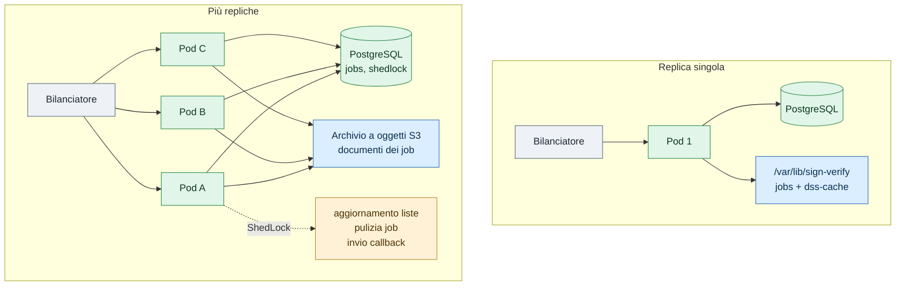
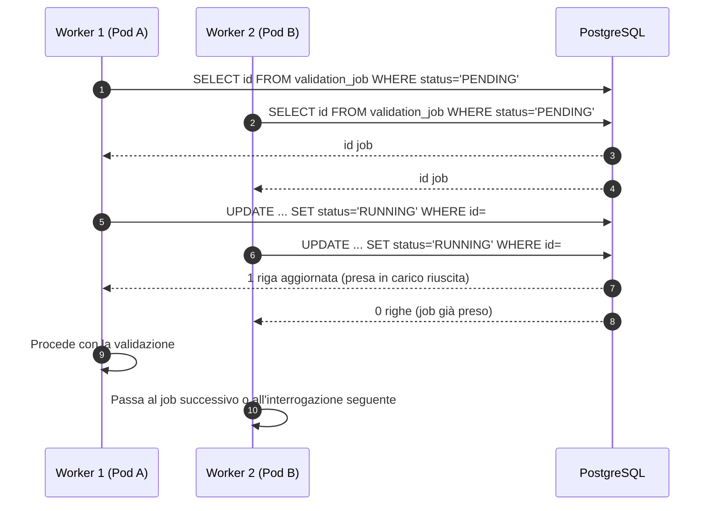

# 7. Scalabilità orizzontale

← [6. Log e audit](07-log-audit.md) · [Indice](README.md)

Il servizio può essere replicato su più istanze quando il carico di verifiche
sincrone o asincrone supera la capacità di un singolo pod. Questa pagina
descrive i meccanismi che rendono sicura la replica e le condizioni in cui
conviene davvero aggiungere istanze.

## 7.1 Quando una replica sola basta, e quando no

Una singola istanza regge bene carichi moderati:

- Le verifiche **sincrone** sono limitate da un semaforo
  (`verify.max-concurrent`, valore predefinito 8). Il numero di verifiche al
  secondo dipende dalla CPU occupata dalla libreria DSS: ogni verifica carica
  catene di certificati, CRL/OCSP e liste di fiducia.
- I job **asincroni** frenano il carico in ingresso con i limiti
  `async.max-pending-per-principal` e `async.max-pending-global`. Quando la coda
  è piena il chiamante riceve 429, quindi il sistema non collassa sotto i picchi.

Aggiungere repliche ha senso quando:

- il semaforo delle verifiche sincrone è saturo per la maggior parte del tempo e
  il chiamante non può tollerare attese;
- la coda asincrona cresce di continuo nonostante i limiti;
- si vuole tolleranza ai guasti: se un pod cade, gli altri continuano a servire
  le verifiche sincrone e a elaborare i job.

## 7.2 Cosa rende il servizio replicabile

### Pod senza stato

I pod non conservano stato proprio. Gli unici percorsi scrivibili sotto
`/var/lib/sign-verify` sono:

| Percorso | Contenuto | Condivisibile? |
|----------|-----------|----------------|
| `jobs/` | Documenti dei job asincroni (su filesystem) | No, è locale al pod |
| `dss-cache/` | Cache di liste di fiducia, CRL e OCSP della libreria DSS | No, è locale al pod |

Lo stato condiviso risiede interamente in **PostgreSQL**, con lo schema gestito
da Flyway. Nello stesso schema vive anche la tabella `shedlock`, usata per le
attività che devono girare su una sola istanza.

### Presa in carico atomica dei job asincroni

I worker di validazione non usano un blocco distribuito. A ogni interrogazione
il worker legge gli identificativi dei job in stato `PENDING` e prova a
prenderli in carico uno a uno con un `UPDATE` condizionale atomico:

```sql
UPDATE validation_job
SET status = 'RUNNING', started_at = :now, pickup_attempts = pickup_attempts + 1
WHERE id = :id
  AND status = 'PENDING';
```

Procede con la validazione solo il worker il cui `UPDATE` modifica una riga
(risultato `1`). Se due repliche competono per lo stesso job, una sola trova la
condizione `status = 'PENDING'` soddisfatta; le altre ricevono zero righe e
passano al job successivo o all'interrogazione seguente (`poll-interval`).

### Attività a istanza singola protette da ShedLock

Alcune operazioni devono girare su un solo pod alla volta. Il servizio usa
**ShedLock con backend JDBC** (tabella `shedlock`). I blocchi configurati sono:

| Nome del blocco | Operazione | Pianificazione predefinita |
|-----------------|------------|----------------------------|
| `tslRefresh` | Aggiornamento delle liste di fiducia | cron `0 0 2 * * *` |
| `jobCleanup` | Pulizia di job e documenti scaduti | cron `0 30 3 * * *` |
| `callbackDispatch` | Invio delle callback HTTP | ogni 10 secondi |

L'operazione la esegue solo il pod che acquisisce il blocco. Se quel pod muore,
il blocco scade dopo il `lockAtMostFor` configurato e un altro pod subentra.

### Memorizzazione dei documenti: filesystem o S3

La modalità predefinita salva i documenti sul filesystem locale
(`APP_STORAGE_JOBS_DIR`). Così ogni pod vede solo i propri file: con più istanze
funzionano le verifiche sincrone, ma non i job asincroni, perché un job creato
sul pod A non è leggibile dal pod B.

Per rendere replicabili anche i job asincroni bisogna attivare la modalità
**S3**:

```yaml
app:
  storage:
    type: s3
    s3:
      endpoint: https://minio.example.org
      region: eu-west-1
      bucket: signverify-jobs
      path-style-access: true   # predefinito false (virtual-hosted, AWS nativo); true per MinIO/Ceph
```

Le variabili d'ambiente corrispondenti sono `APP_STORAGE_TYPE`,
`APP_STORAGE_S3_ENDPOINT`, `APP_STORAGE_S3_REGION`, `APP_STORAGE_S3_BUCKET` e
`APP_STORAGE_S3_PATH_STYLE`. Le credenziali **non** sono una proprietà
applicativa: il client di AWS SDK v2 le cerca sempre nella catena predefinita
(variabili `AWS_ACCESS_KEY_ID` e `AWS_SECRET_ACCESS_KEY`, ruoli IAM o IRSA,
profili locali), così nessun segreto finisce nella configurazione versionata.

Le chiavi degli oggetti sono relative:

- `{jobId}/input-{safeName}` per il documento caricato;
- `{jobId}/result.json` per il risultato della validazione.

Il percorso relativo viene salvato nel campo `document_path` del job, quindi
qualsiasi replica riesce a risolverlo e a leggere il documento.

All'avvio l'adattatore S3 esegue una `headBucket` bloccante: se il bucket non è
raggiungibile il servizio si arresta subito, invece di fallire più tardi sulla
prima richiesta.

### Controlli di salute e bilanciamento

Il bilanciatore di carico deve interrogare due endpoint di Actuator:

| Endpoint | Scopo | Risposta |
|----------|-------|----------|
| `/actuator/health/liveness` | Sonda di vitalità (Kubernetes) | 200 UP se il processo è vivo |
| `/actuator/health/readiness` | Sonda di prontezza (bilanciatore, orchestratore) | 200 UP solo a liste di fiducia pronte |

La prontezza include `TslReadinessIndicator`: un pod che non ha ancora
completato il primo caricamento delle liste di fiducia resta fuori dal traffico.

L'arresto è controllato (`server.shutdown: graceful`): alla ricezione di
`SIGTERM` il container completa le richieste in corso prima di uscire.

### Limitazione del carico in ingresso

Le leve che frenano il carico restano valide anche con più repliche:

| Parametro | Effetto |
|-----------|---------|
| `verify.max-concurrent` | Semaforo delle verifiche sincrone, **per singolo pod** |
| `async.workers` | Thread che interrogano la coda e prendono in carico i job, **per singolo pod** |
| `async.max-pending-per-principal` | Limite di coda per chiamante (globale, su database) |
| `async.max-pending-global` | Limite di coda complessivo (globale, su database) |

Aumentare le repliche moltiplica le verifiche sincrone servibili e il numero di
worker asincroni, ma i limiti globali sui job in attesa restano quelli.

### Metriche per la scalatura automatica

Le metriche Prometheus esposte su `/actuator/prometheus` includono:

| Metrica | Tipo | Uso |
|---------|------|-----|
| `signverify.async.jobs.pending` | Gauge | Numero di job in attesa |
| `signverify.async.jobs.running` | Gauge | Numero di job in esecuzione |
| `signverify.storage.s3.operation` | Timer | Latenza delle operazioni S3 |
| `signverify.storage.s3.bytes` | DistributionSummary | Byte letti e scritti su S3 |

Sono metriche adatte a un Horizontal Pod Autoscaler di Kubernetes: si può
scalare sui job in attesa oppure sulla latenza di S3.

## 7.3 Limiti da conoscere

La cache della libreria DSS (`dss-cache/`) resta locale a ogni pod, mentre
l'aggiornamento delle liste di fiducia gira su un solo pod grazie a ShedLock. La
correttezza della validazione non dipende da una cache condivisa: ogni replica
può scaricare per conto proprio liste di fiducia, CRL e OCSP. Un pod appena
creato però parte con la cache vuota, quindi le prime verifiche dopo un rilascio
o un riavvio sono più lente.

## 7.4 Procedura operativa: passare da filesystem a S3

Le due modalità non si mescolano:

- su filesystem vengono salvati **percorsi assoluti**, locali al pod;
- su S3 vengono salvate **chiavi relative** all'interno del bucket.

Non esiste una migrazione automatica dei documenti. La procedura consigliata è:

1. **Fermare gli invii**: smettere di accettare nuovi job, per esempio mettendo
   in manutenzione l'endpoint `/jobs`.
2. **Svuotare la coda**: attendere che tutti i job in stato `PENDING` o
   `RUNNING` arrivino a uno stato terminale.
3. **Configurare S3**: impostare `APP_STORAGE_TYPE=s3` e le variabili
   `APP_STORAGE_S3_*`, con il bucket già creato e le credenziali raggiungibili
   dalla catena predefinita dell'SDK (ruolo IAM o IRSA, oppure variabili
   d'ambiente).
4. **Riavviare**: rilanciare tutti i pod. I nuovi job useranno S3; i vecchi job
   su filesystem non sono più referenziati e vengono rimossi da `jobCleanup` alla
   scadenza dei tempi di conservazione.

## 7.5 Diagrammi

### Una replica sola e più repliche a confronto



### Presa in carico atomica di un job



## 7.6 Prerequisiti prima di aggiungere repliche

Prima di replicare il servizio in produzione, verificare questi punti:

- [ ] **S3 attivo**: `APP_STORAGE_TYPE=s3` e tutte le variabili
  `APP_STORAGE_S3_*` configurate, con il bucket raggiungibile.
- [ ] **PostgreSQL esterno**: un database gestito, non H2 in memoria; deve
  reggere le connessioni di tutte le repliche previste.
- [ ] **Bilanciatore sulla prontezza**: il bilanciatore deve usare
  `/actuator/health/readiness` per escludere i pod non ancora pronti.
- [ ] **Limiti di risorse**: per via della libreria DSS ogni replica consuma
  parecchia CPU e memoria; impostare `requests` e `limits` adeguati.
- [ ] **Chiave master condivisa**: `APP_SECRET_MASTER_KEY` identica su tutti i
  pod, passata da variabile d'ambiente o da un Secret, mai generata localmente.
